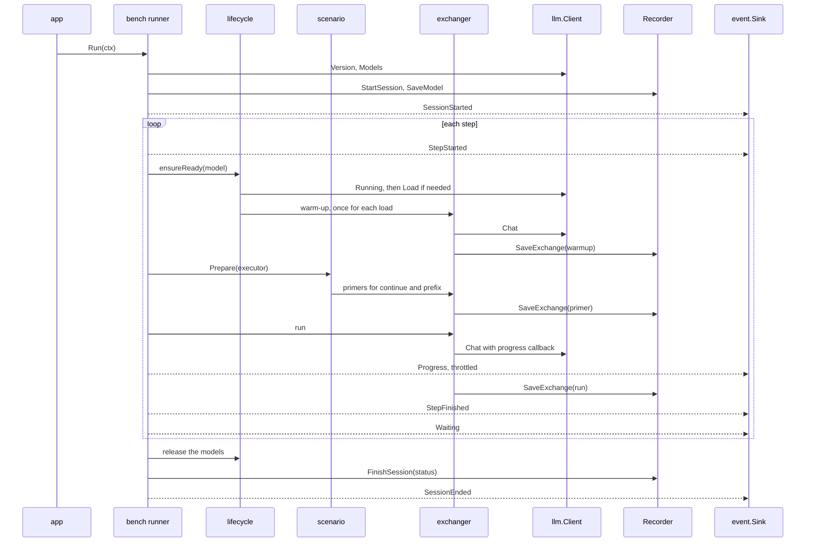

# dyno: implementation plan

|            |                                                                |
| ---------- | -------------------------------------------------------------- |
| Status     | Implemented on 2026-10-05; sections 19 and 20 list the changes |
| Date       | 2026-10-05                                                     |
| Owner      | Max                                                            |
| Target     | Go 1.27, Ollama 0.34.0, macOS on Apple Silicon                 |
| Repository | `~/dev/token-rate`, branch `main`, no remote                   |

## Contents

1. [Summary](#1-summary)
2. [Glossary](#2-glossary)
3. [Scope](#3-scope)
4. [Requirements](#4-requirements)
5. [Verified facts](#5-verified-facts)
6. [Design decisions](#6-design-decisions)
7. [Architecture](#7-architecture)
8. [Core types and ports](#8-core-types-and-ports)
9. [Components](#9-components)
10. [Measurement protocol](#10-measurement-protocol)
11. [Storage](#11-storage)
12. [Command-line interface](#12-command-line-interface)
13. [TUI](#13-tui)
14. [Testing](#14-testing)
15. [Tooling and conventions](#15-tooling-and-conventions)
16. [Phases and milestones](#16-phases-and-milestones)
17. [Risks](#17-risks)
18. [Open decisions](#18-open-decisions)
19. [Implementation notes](#19-implementation-notes)
20. [Rename and other LLM servers](#20-rename-and-other-llm-servers)

## 1. Summary

`dyno` is a command-line tool. It measures how fast local models generate
tokens through Ollama. It also measures the effect of the prompt cache.

The tool runs the selected models one after the other. It repeats each
measurement and waits for a set interval between runs. Every request goes into a
SQLite file, so the report can average all runs over time.

The tool is one Go binary. It shows a TUI in a terminal. It writes plain text
when the output is not a terminal, for example under `launchd`.

## 2. Glossary

This plan uses each term below with one meaning only.

| Term         | Meaning                                                                                                                   |
| ------------ | ------------------------------------------------------------------------------------------------------------------------- |
| Session      | One execution of `dyno run`.                                                                                              |
| Step         | One scheduled measurement: a model, a cache mode, and a run number.                                                       |
| Run          | The measured request of a step. `--runs N` sets the number of runs for each model and each cache mode.                    |
| Exchange     | One chat request and its measured response. An exchange is a warm-up, a primer, or a run. The store keeps every exchange. |
| Warm-up      | The first request after a model load. The report does not count it.                                                       |
| Primer       | A request that fills the cache before a run. The report does not count it.                                                |
| Cache mode   | The way the tool prepares the prompt cache before a run: `miss`, `continue`, or `prefix`.                                 |
| Workload     | The prompt text and the generation settings. Runs with the same workload hash are comparable.                             |
| Prefill      | The phase in which the server reads the prompt, before the first output token.                                            |
| Decode       | The phase in which the server generates the output tokens.                                                                |
| TTFT         | Time to first token. The client measures it.                                                                              |
| Cached share | The part of the prompt that the server took from its cache, from 0 to 1.                                                  |

## 3. Scope

### 3.1 In scope

- A `run` command with models, runs, interval, order, cache modes, prompt,
  generation settings, and a tag.
- Three cache modes: `miss`, `continue`, and `prefix`.
- Two built-in prompts, `short` and `long`, and prompt files in JSON.
- A SQLite store for sessions, models, and exchanges.
- A `report` command that filters, groups, and summarizes runs across all
  sessions.
- A `models` command that lists the local models and their details.
- A TUI for `run` and `report`, and plain text for pipes and `launchd`.
- A `launchd` template for scheduled sessions.

### 3.2 Out of scope

- Load tests with parallel requests.
- Servers other than Ollama.
- Sweeps over context length.
- Upload of results to a remote service.

### 3.3 Assumptions

- Ollama runs on the same Mac. The default address is `http://127.0.0.1:11434`.
- Only one session runs at a time.
- The user pulls the models before a session.
- The server settings, such as `OLLAMA_KV_CACHE_TYPE`, do not change during a
  session. The API does not report these settings. The user marks a changed
  setup with `--tag`.
- The primary platform is macOS on Apple Silicon. The code stays portable. Only
  macOS gets tests on real hardware.

## 4. Requirements

### 4.1 Functional requirements

| ID    | Requirement                                                                                                                                                              |
| ----- | ------------------------------------------------------------------------------------------------------------------------------------------------------------------------ |
| FR-1  | The tool must run the models that `--models` selects. It must stop before the first request if a model is not on the server.                                             |
| FR-2  | The tool must do `--runs N` runs for each model and each cache mode.                                                                                                     |
| FR-3  | The tool must wait `--interval` after each run. It must not wait after the last run.                                                                                     |
| FR-4  | The tool must run the steps one after the other, in `model` order or in `round-robin` order.                                                                             |
| FR-5  | The tool must support the cache modes `miss`, `continue`, and `prefix`.                                                                                                  |
| FR-6  | The tool must offer the built-in prompts `short` and `long`. It must also read prompt files.                                                                             |
| FR-7  | The tool must write every session, model, and exchange to SQLite immediately.                                                                                            |
| FR-8  | The `report` command must filter, group, and summarize runs across all sessions. The summary contains the count, median, mean, standard deviation, minimum, and maximum. |
| FR-9  | The tool must show a TUI in a terminal. It must write plain text when the output is not a terminal, or when the user sets `--plain`.                                     |
| FR-10 | The `models` command must list the local models with digest, format, family, size, quantization, and the thinking capability.                                            |
| FR-11 | The user must be able to stop a session with `q` or Ctrl-C. The finished exchanges must stay in the store.                                                               |
| FR-12 | After a session, the tool must show the results of the session next to the all-time results for the same workload.                                                       |

### 4.2 Non-functional requirements

| ID                     | Requirement                                                                                                                                                                                     |
| ---------------------- | ----------------------------------------------------------------------------------------------------------------------------------------------------------------------------------------------- |
| NFR-1 Accuracy         | The decode and prefill rates must come from the server timings. The formulas must be the same as in `ollama run --verbose`. The client must record TTFT in the goroutine that reads the stream. |
| NFR-2 Low interference | The runner must publish at most 10 progress events per second. The TUI must not redraw for each token.                                                                                          |
| NFR-3 Durability       | Each exchange must be one committed write. A crash must lose at most the current request.                                                                                                       |
| NFR-4 Runtime          | The tool must be one binary without cgo. It must run under `launchd` with no interpreter and no environment setup.                                                                              |
| NFR-5 Testability      | The core must run in tests without a server, a terminal, or a real clock. The core packages must have at least 80 % statement coverage.                                                         |
| NFR-6 Maintainability  | Each package, type, and function must have one responsibility. Dependencies must point inward. The code must have no mutable global state.                                                      |
| NFR-7 Comparability    | Each run must record the model digest, the Ollama version, and the workload hash. By default, the report must not mix different values of these fields.                                         |

## 5. Verified facts

I checked these facts with live requests on 2026-10-05. The setup was Ollama
0.34.0 on an Apple M5 Pro with 48 GB of RAM.

| Fact                                                                                                                                                                                                                                        | Effect on the design                                                                                                                  |
| ------------------------------------------------------------------------------------------------------------------------------------------------------------------------------------------------------------------------------------------- | ------------------------------------------------------------------------------------------------------------------------------------- |
| The responses contain `eval_count`, `eval_duration`, `prompt_eval_count`, `prompt_eval_cached_count`, `prompt_eval_duration`, `load_duration`, and `total_duration`.                                                                        | The store keeps these raw values. The report calculates the rates.                                                                    |
| `ollama run --verbose` calculates "eval rate" as `eval_count / eval_duration`. It calculates "prompt eval rate" with the uncached tokens only.                                                                                              | `domain.ServerMetrics` uses the same formulas.                                                                                        |
| All three target models list the `thinking` capability and accept `"think": false`.                                                                                                                                                         | The adapter sends `think: false` only to models with this capability.                                                                 |
| On the MLX engine, the first request after a load had a slow prefill: 260 ms, against 41 ms later.                                                                                                                                          | The tool sends a warm-up after each load.                                                                                             |
| A unique ID at the start of the prompt gave 0 cached tokens on both engines.                                                                                                                                                                | The `miss` mode puts the ID at the start.                                                                                             |
| The next turn of a chat reused at least 99 % of the prompt on all three models.                                                                                                                                                             | The `continue` mode needs one primer.                                                                                                 |
| With the same system prompt and a new question, the MLX models reused 99 % only after two earlier requests with that prefix. In one test, they lost the prefix again after three hits. The LFM model reused 75 % after one earlier request. | The `prefix` mode reloads the model and sends two primers before each run. The store records the real cached count of every exchange. |
| `ChatRequest` has the fields `Truncate` and `Shift`. With `false`, the server returns an error instead of a cut prompt or a shifted context.                                                                                                | The adapter sets both fields to `false`. A prompt that is too long fails visibly.                                                     |
| `ollama run` has no flags for `num_predict`, `temperature`, or `seed`.                                                                                                                                                                      | The tool uses the API.                                                                                                                |
| The default `launchd` PATH has no pyenv and no `uv`. On that PATH, `python3` is Apple's Python 3.9.6.                                                                                                                                       | The tool is a Go binary. See D1.                                                                                                      |

Results of the cache test. Each prompt had 4,000 to 4,400 tokens. Each cell
shows the prefill time and the cached share.

| Model            | `miss`         | `continue`   | `prefix`      |
| ---------------- | -------------- | ------------ | ------------- |
| `qwen3.5:4b-mlx` | 1,940 ms · 0 % | 56 ms · 99 % | 43 ms · 99 %  |
| `qwen3.5:9b-mlx` | 3,125 ms · 0 % | 93 ms · 99 % | 63 ms · 99 %  |
| `lfm2.5:8b`      | 1,070 ms · 0 % | 50 ms · 99 % | 302 ms · 75 % |

Module versions on 2026-10-05:

| Module                                 | Version | Use                                                                 |
| -------------------------------------- | ------- | ------------------------------------------------------------------- |
| `github.com/ollama/ollama`             | v0.34.0 | `api` package: client and types. The module needs Go 1.26 or later. |
| `charm.land/bubbletea/v2`              | v2.0.10 | TUI runtime                                                         |
| `charm.land/bubbles/v2`                | v2.2.1  | `progress`, `spinner`, `table`, `help`, `key`                       |
| `charm.land/lipgloss/v2`               | v2.0.6  | styles, layout, `LightDark`                                         |
| `github.com/NimbleMarkets/ntcharts/v2` | v2.6.0  | `timeserieslinechart`, `sparkline`                                  |
| `modernc.org/sqlite`                   | v1.60.1 | SQLite driver without cgo                                           |
| `golang.org/x/term`                    | v0.46.0 | terminal detection                                                  |
| `github.com/charmbracelet/x/ansi`      | v0.11.8 | removes ANSI codes in golden tests                                  |
| `honnef.co/go/tools`                   | v0.8.1  | `staticcheck`, as a `go tool`                                       |

The `main` branch of ntcharts still uses Bubble Tea v1. The tool must import
`github.com/NimbleMarkets/ntcharts/v2`.

## 6. Design decisions

| ID  | Decision                                                                                      | Reason                                                                                                                                                   | Rejected options                                                                                                       |
| --- | --------------------------------------------------------------------------------------------- | -------------------------------------------------------------------------------------------------------------------------------------------------------- | ---------------------------------------------------------------------------------------------------------------------- |
| D1  | Go 1.27 and one binary.                                                                       | The binary runs under `launchd` without setup. The Ollama client is typed. A goroutine keeps TTFT exact. The compiler checks code paths that seldom run. | A Python script. It has the `launchd` PATH problem and a GIL delay of up to 5 ms on TTFT.                              |
| D2  | Ports and adapters, with a functional core.                                                   | The core runs in tests without a server. Each third-party API stays in one adapter.                                                                      | One package. It is fast to start and hard to test.                                                                     |
| D3  | The official `api` package behind the `llm.Client` port.                                      | The tool gets the same types and formulas as the Ollama CLI.                                                                                             | An own HTTP client. It needs more code, and its fields drift. The cost of D3 is a one-time module download of 31.5 MB. |
| D4  | SQLite with `modernc.org/sqlite`. Three tables. Raw values only.                              | One file, SQL filters, safe writes, and no cgo. The rates stay recomputable.                                                                             | CSV or JSONL files have no queries. DuckDB needs cgo.                                                                  |
| D5  | Statistics in Go, not in SQL.                                                                 | One implementation serves the plain report, the TUI, and the summary after a session. The code is pure and testable.                                     | SQL aggregates. Core SQLite has no standard deviation, and `median()` depends on the build.                            |
| D6  | Cache modes as strategies, with a small `Executor` capability.                                | A new mode needs no change in the runner. Each strategy has tests with a fake executor.                                                                  | `switch` statements in the runner.                                                                                     |
| D7  | Typed events and sinks.                                                                       | The runner does not know the UI. The TUI bridge never blocks the runner.                                                                                 | Direct calls from the runner into the UI.                                                                              |
| D8  | Bubble Tea v2, Bubbles v2, Lip Gloss v2, and ntcharts v2. Plain mode does not use Bubble Tea. | The versions are current and compatible. Plain mode works without a terminal.                                                                            | `tea.WithoutRenderer()` for plain mode. It couples plain output to Bubble Tea.                                         |
| D9  | The standard library `flag` package, with one `FlagSet` for each command.                     | Four commands do not need a framework.                                                                                                                   | Cobra. It adds dependencies.                                                                                           |
| D10 | The store keeps every exchange: warm-ups, primers, and runs.                                  | The cache behavior depends on the request history. The full history makes the behavior visible.                                                          | Only runs. That choice hides cache problems.                                                                           |
| D11 | A workload hash over the prompt text and the generation settings.                             | The report never mixes different workloads by accident.                                                                                                  | Groups by prompt name. A changed prompt text would mix silently.                                                       |
| D12 | The clock, the unique IDs, and the host facts are injected.                                   | Tests are deterministic.                                                                                                                                 | Direct calls to `time.Now` and `crypto/rand` in the core.                                                              |

## 7. Architecture

### 7.1 Layers

```text
┌──────────────────────────────────────────────────────────────────────┐
│ cmd/dyno              main: cli.Parse → app.<command> → exit code    │
├──────────────────────────────────────────────────────────────────────┤
│ internal/app          composition root, one file for each command    │
├───────────────────────────────┬──────────────────────────────────────┤
│ Presentation                  │ Adapters                             │
│   ui/plain                    │   ollama        implements llm.Client│
│   ui/tui                      │   store/sqlite  implements           │
│   (event.Sink, report views)  │                 bench.Recorder and   │
│                               │                 report.Source        │
│                               │   sysinfo       host, power, version │
├───────────────────────────────┴──────────────────────────────────────┤
│ Application core                                                     │
│   bench     runner, schedule, model lifecycle, exchanger             │
│   scenario  miss, continue, prefix                                   │
│   report    filter, validity, grouping, summaries                    │
│   prompt    prompt sets, unique IDs        event   events and Sink   │
├──────────────────────────────────────────────────────────────────────┤
│ Domain and ports      domain      llm (port)      stats              │
└──────────────────────────────────────────────────────────────────────┘
  Dependencies point down only. The core never imports an adapter,
  a UI package, or a third-party module.
```

### 7.2 Package layout

```text
dyno/
├── cmd/dyno/main.go           entry point: parse, dispatch, exit code
├── internal/
│   ├── app/                         composition root
│   │   ├── run.go                   wires runner, store, client, SessionUI
│   │   ├── report.go                wires source and ReportUI
│   │   ├── models.go
│   │   ├── version.go
│   │   └── deps.go                  newClient, openStore, chooseUI
│   ├── cli/                         arguments → command values
│   │   ├── cli.go                   Parse, command types, ErrUsage
│   │   ├── run.go  report.go  models.go
│   │   └── values.go                flag.Value types: lists, modes, order, dates
│   ├── domain/                      core types, standard library only
│   │   ├── cachemode.go  order.go  message.go  model.go  metrics.go
│   │   └── workload.go  step.go  exchange.go  session.go
│   ├── llm/                         port: what the core needs from a server
│   │   ├── client.go
│   │   └── llmtest/fake.go          scriptable fake client
│   ├── ollama/                      adapter on github.com/ollama/ollama/api
│   │   ├── client.go  request.go  response.go  errors.go
│   │   └── testdata/*.ndjson        recorded streams from Ollama 0.34.0
│   ├── prompt/                      prompt sets, unique IDs, hashes
│   │   └── set.go  builtin.go  file.go  ids.go
│   ├── scenario/                    cache-mode strategies
│   │   └── scenario.go  turn.go  miss.go  continue.go  prefix.go
│   ├── bench/                       session orchestration
│   │   ├── options.go  schedule.go  runner.go  session.go  lifecycle.go
│   │   ├── exchanger.go  executor.go  throttle.go  clock.go
│   │   └── benchtest/clock.go       fake clock
│   ├── event/                       typed events and the Sink port
│   │   ├── event.go
│   │   └── eventtest/recorder.go
│   ├── stats/summary.go             descriptive statistics
│   ├── report/                      filter, validity, grouping, summaries
│   │   └── filter.go  row.go  validity.go  group.go  build.go  series.go
│   ├── store/sqlite/                adapter for persistence
│   │   ├── open.go  migrate.go  recorder.go  source.go  query.go
│   │   └── migrations/0001_init.sql
│   ├── sysinfo/                     host name, power source, tool version
│   │   └── host.go  power_darwin.go  power_other.go  version.go
│   ├── ui/
│   │   ├── plain/                   session.go  report.go  models.go
│   │   └── tui/
│   │       ├── sink.go              non-blocking bridge to tea.Program
│   │       ├── session.go           SessionUI on Bubble Tea
│   │       ├── report.go            ReportUI on Bubble Tea
│   │       ├── theme/theme.go       all styles
│   │       ├── runview/             state.go (pure reducer), model.go, view.go, keys.go
│   │       └── reportview/          model.go, view.go, charts.go, keys.go
│   └── archtest/imports_test.go     checks the dependency rules
├── deploy/launchd/dyno.plist.tmpl
├── scripts/
│   ├── capture-fixtures.sh          records chat streams for the adapter tests
│   └── install-agent.sh             fills the plist template and loads it
├── plans/
├── justfile
├── go.mod
├── .gitignore
└── README.md
```

### 7.3 Dependency rules

| Package                  | Permitted imports inside the module            | Forbidden                         |
| ------------------------ | ---------------------------------------------- | --------------------------------- |
| `domain`, `stats`        | none                                           | everything else                   |
| `llm`, `prompt`, `event` | `domain`                                       | adapters, UI, `bench`             |
| `scenario`               | `domain`, `prompt`                             | `bench`, adapters, UI             |
| `bench`                  | `domain`, `llm`, `prompt`, `scenario`, `event` | adapters, UI, third-party modules |
| `report`                 | `domain`, `stats`                              | adapters, UI, `bench`             |
| `ollama`                 | `domain`, `llm`                                | `bench`, `report`, UI             |
| `store/sqlite`           | `domain`, `report`                             | `bench`, UI                       |
| `sysinfo`                | `domain`                                       | everything else                   |
| `ui/plain`, `ui/tui/...` | `domain`, `event`, `report`, `stats`           | `bench`, adapters                 |
| `cli`                    | `domain`, `llm`, `prompt`, `bench`, `report`   | adapters, UI                      |
| `app`                    | all packages above                             | none                              |
| `cmd/dyno`               | `cli`, `app`                                   | none                              |

The test `internal/archtest` reads `go list -json ./...`. It fails on a
forbidden import. Only `ollama`, `store/sqlite`, and `ui/tui` import third-party
modules. The one exception is `app`, which imports `golang.org/x/term` for the
terminal check.

The SQLite adapter implements `bench.Recorder` without an import of `bench`,
because Go interfaces are structural.

### 7.4 Session flow



### 7.5 Concurrency

- In plain mode, the runner runs in the main goroutine.
- In TUI mode, Bubble Tea owns the main goroutine. The runner runs in one more
  goroutine. The `tui.Sink` goroutine forwards events to the program.
- The Ollama client calls the stream callback in the runner goroutine. The
  adapter records TTFT as the first statement of that callback.
- `tea.Program.Send` blocks until the program reads the message. Thus the runner
  never calls `Send`. The sink buffers the events. When the buffer is full, it
  drops `Progress` events. It never drops other events.
- To stop, the TUI calls the `cancel` function of the session context. The
  runner stops the current request and does not store it. It finishes the
  session as `aborted` and returns. The TUI quits after the runner returns.
- The runner uses `context.WithoutCancel` for the cleanup. Thus the unload
  requests and the final session status still go out after a cancel.
- The goroutines share no mutable data. They communicate only through channels
  and `tea.Program.Send`.

### 7.6 Errors and exit codes

| Condition                       | Source                                       | Effect                                                                                 | Exit code    |
| ------------------------------- | -------------------------------------------- | -------------------------------------------------------------------------------------- | ------------ |
| Wrong arguments                 | `cli`                                        | Print the usage text.                                                                  | 2            |
| Invalid options                 | `bench.Options.Validate`                     | Print all problems at once.                                                            | 2            |
| Server not available            | `llm.ErrUnavailable`                         | Finish the session as `failed`.                                                        | 1            |
| Model not found                 | `llm.ErrModelNotFound` before the first step | Stop before the first request.                                                         | 1            |
| One request fails               | any other error from `Chat`                  | Record the exchange with the error. Publish `StepFailed`. Continue with the next step. | 1 at the end |
| Stop by the user or by a signal | `context.Canceled`                           | Finish the session as `aborted`.                                                       | 130          |
| No problem                      | none                                         | Finish the session as `completed`.                                                     | 0            |

Rules for errors:

- Each layer adds context with `fmt.Errorf("...: %w", err)`.
- Callers use `errors.Is` and `errors.As`. They never compare error strings.
- Only the ports define sentinel errors.
- No package calls `panic`.

### 7.7 Reuse

- `exchanger.send` is the only code that sends a chat request and records it.
  Warm-ups, primers, and runs use it.
- `scenario.firstTurn` builds the first turn for all three modes. Only the
  position of the unique ID changes.
- `report.Build` makes every summary: the `report` command, the TUI report, and
  the summary after a session.
- `stats.Summarize` makes every statistic.
- `event.Sink` serves both UIs.
- `theme.Theme` holds every TUI style. The views do not create styles.
- `app.newClient` and `app.openStore` serve all commands.

## 8. Core types and ports

The code in this section is a sketch. The final code can differ in details, but
not in structure.

### 8.1 `domain`

```go
package domain

// CacheMode selects how the tool prepares the prompt cache before a run.
type CacheMode string

const (
	CacheMiss     CacheMode = "miss"     // new chat, unique ID at the start
	CacheContinue CacheMode = "continue" // next turn of the same chat
	CachePrefix   CacheMode = "prefix"   // new question after the same system prompt
)

// ParseCacheMode converts user input into a CacheMode.
func ParseCacheMode(s string) (CacheMode, error)

// Order selects the sequence of the steps in a session.
type Order string

const (
	OrderModel      Order = "model"       // all runs of a model, then the next model
	OrderRoundRobin Order = "round-robin" // run 1 of every model, then run 2, ...
)

// Step is one scheduled measurement.
type Step struct {
	Model string
	Mode  CacheMode
	Run   int // 1-based
}

// ExchangeKind tells why the tool sent a request.
type ExchangeKind string

const (
	KindWarmup ExchangeKind = "warmup"
	KindPrimer ExchangeKind = "primer"
	KindRun    ExchangeKind = "run"
)

// Exchange is one chat request and its measured response.
type Exchange struct {
	Session     SessionID
	Step        Step
	Model       Model
	Kind        ExchangeKind
	StartedAt   time.Time
	Measurement Measurement // zero when Err is not empty
	Err         string
}

// Model describes one local model.
type Model struct {
	Name         string // for example "qwen3.5:9b-mlx"
	Digest       string
	Format       string // "safetensors" (MLX engine) or "gguf"
	Family       string // for example "qwen3_5" or "lfm2moe"
	Parameters   string // for example "9.4B"
	Quantization string // for example "nvfp4" or "Q4_K_M"
	SizeBytes    int64
	Thinking     bool // the model lists the "thinking" capability
}
```

```go
package domain

// ServerMetrics holds the timings that the server reports for one request.
type ServerMetrics struct {
	PromptTokens   int
	CachedTokens   int
	PromptDuration time.Duration
	EvalTokens     int
	EvalDuration   time.Duration
	LoadDuration   time.Duration
	TotalDuration  time.Duration
}

// DecodeRate returns the generated tokens per second.
func (m ServerMetrics) DecodeRate() float64 {
	return perSecond(m.EvalTokens, m.EvalDuration)
}

// PrefillRate returns the evaluated prompt tokens per second. It leaves out
// the cached tokens, like "prompt eval rate" in `ollama run --verbose`.
func (m ServerMetrics) PrefillRate() float64 {
	return perSecond(max(0, m.PromptTokens-m.CachedTokens), m.PromptDuration)
}

// CachedShare returns the part of the prompt that came from the cache.
func (m ServerMetrics) CachedShare() float64 {
	if m.PromptTokens == 0 {
		return 0
	}
	return float64(m.CachedTokens) / float64(m.PromptTokens)
}

func perSecond(n int, d time.Duration) float64 {
	if d <= 0 {
		return 0
	}
	return float64(n) / d.Seconds()
}

// ClientMetrics holds the timings that the client measures for one request.
type ClientMetrics struct {
	TimeToFirstToken time.Duration // zero if no token arrived
	Wall             time.Duration
}

// Measurement is the full result of one request.
type Measurement struct {
	Server     ServerMetrics
	Client     ClientMetrics
	DoneReason string // "length" when the model reached num_predict
}
```

```go
package domain

// Workload holds every request setting that changes the speed.
type Workload struct {
	PromptName  string
	PromptHash  string
	NumPredict  int
	NumCtx      int
	Temperature float64
	Seed        int
}

// Hash returns a short, stable ID. The prompt name is not part of it.
func (w Workload) Hash() string {
	sum := sha256.Sum256(fmt.Appendf(nil, "v1|%s|%d|%d|%g|%d",
		w.PromptHash, w.NumPredict, w.NumCtx, w.Temperature, w.Seed))
	return hex.EncodeToString(sum[:6])
}

// Role is the author of a message.
type Role string

const (
	RoleSystem    Role = "system"
	RoleUser      Role = "user"
	RoleAssistant Role = "assistant"
)

type Message struct {
	Role    Role
	Content string
}

// Conversation is an ordered list of messages. Its methods never change
// the receiver.
type Conversation []Message

// With returns a new conversation with msgs at the end.
func (c Conversation) With(msgs ...Message) Conversation {
	return append(slices.Clone(c), msgs...)
}

type SessionID string

type SessionStatus string

const (
	StatusRunning   SessionStatus = "running"
	StatusCompleted SessionStatus = "completed"
	StatusAborted   SessionStatus = "aborted"
	StatusFailed    SessionStatus = "failed"
)

// Session holds the facts that are the same for every exchange of a session.
type Session struct {
	ID            SessionID
	StartedAt     time.Time
	ToolVersion   string
	OllamaVersion string
	Host          Host
	Tag           string
	Workload      Workload
	Order         Order
	Interval      time.Duration
	Runs          int
	CacheModes    []CacheMode
}

type Host struct {
	Name        string
	PowerSource string // "ac", "battery", or "unknown"
}
```

### 8.2 `llm`: the server port

```go
package llm

// GenerationOptions are the sampling and context settings of a request.
type GenerationOptions struct {
	MaxTokens   int // num_predict
	ContextSize int // num_ctx
	Temperature float64
	Seed        int
}

type ChatRequest struct {
	Model        domain.Model
	Conversation domain.Conversation
	Options      GenerationOptions
	KeepAlive    time.Duration
}

type ChatResult struct {
	Reply       domain.Message
	Measurement domain.Measurement
}

// ProgressFunc receives the number of streamed tokens so far. The count is
// approximate. The final count comes from the server metrics.
type ProgressFunc func(tokens int)

// Client is what the core needs from an LLM server.
type Client interface {
	Version(ctx context.Context) (string, error)
	Models(ctx context.Context) ([]domain.Model, error)
	Running(ctx context.Context) ([]string, error)
	Load(ctx context.Context, model string, keepAlive time.Duration) (time.Duration, error)
	Unload(ctx context.Context, model string) error
	// Chat streams one request. progress can be nil.
	Chat(ctx context.Context, req ChatRequest, progress ProgressFunc) (ChatResult, error)
}

var (
	ErrUnavailable   = errors.New("llm server is not available")
	ErrModelNotFound = errors.New("model not found")
)
```

### 8.3 `scenario`: the cache-mode strategies

```go
package scenario

// Executor gives a scenario the actions that it needs. The runner binds an
// executor to one step and one model.
type Executor interface {
	// Reload unloads the model, loads it again, and warms it up.
	Reload(ctx context.Context) error
	// Prime sends a request that is not measured and returns the reply.
	Prime(ctx context.Context, conv domain.Conversation, maxTokens int) (domain.Message, error)
}

// Scenario prepares the server cache for one cache mode. It returns the
// conversation of the measured request.
type Scenario interface {
	Mode() domain.CacheMode
	Prepare(ctx context.Context, exec Executor) (domain.Conversation, error)
}

// New returns the scenario for mode. It fails if set cannot serve the mode.
func New(mode domain.CacheMode, set prompt.Set, ids prompt.IDSource) (Scenario, error)
```

### 8.4 `bench`: ports that the runner needs

```go
package bench

// Recorder stores sessions, models, and exchanges. Each call commits at once.
type Recorder interface {
	StartSession(ctx context.Context, s domain.Session) error
	SaveModel(ctx context.Context, m domain.Model) error
	SaveExchange(ctx context.Context, x domain.Exchange) error
	FinishSession(ctx context.Context, id domain.SessionID, status domain.SessionStatus, at time.Time) error
}

// Clock gives the time and waits. Tests use benchtest.Clock.
type Clock interface {
	Now() time.Time
	// Sleep waits for d. It returns ctx.Err() if ctx ends first.
	Sleep(ctx context.Context, d time.Duration) error
}

// Options configure one session. The cli package fills them.
type Options struct {
	Models         []string
	Runs           int
	Interval       time.Duration
	Order          domain.Order
	CacheModes     []domain.CacheMode
	Prompt         prompt.Set
	Generation     llm.GenerationOptions
	KeepAlive      time.Duration
	RequestTimeout time.Duration
	Tag            string
	ProgressEvery  time.Duration // 100 ms
}

// Deps are the collaborators of a Runner.
type Deps struct {
	Client   llm.Client
	Recorder Recorder
	Sink     event.Sink
	Clock    Clock
	IDs      prompt.IDSource
	Meta     Meta
}

// Meta holds the facts about the tool and the host for the session row.
type Meta struct {
	Tool string
	Host domain.Host
}

// NewRunner validates the options and builds one scenario for each cache mode.
func NewRunner(d Deps, o Options) (*Runner, error)
```

### 8.5 `event`: what the runner publishes

```go
package event

// Event is a fact that the runner publishes.
type Event interface{ isEvent() }

// Lossy marks an event that a sink is permitted to drop under load.
type Lossy interface {
	Event
	lossy()
}

type (
	SessionStarted struct {
		Session domain.Session
		Steps   []domain.Step
	}
	ModelLoading struct{ Model string }
	ModelReady   struct {
		Model string
		Load  time.Duration
	}
	StepStarted struct {
		Index, Total int
		Step         domain.Step
	}
	Preparing struct {
		Step   domain.Step
		Action string // "reload" or "primer"
	}
	Progress struct {
		Step    domain.Step
		Tokens  int
		Elapsed time.Duration
	}
	StepFinished struct {
		Step     domain.Step
		Exchange domain.Exchange
	}
	StepFailed struct {
		Step domain.Step
		Err  error
	}
	Waiting      struct{ Until time.Time }
	SessionEnded struct {
		ID     domain.SessionID
		Status domain.SessionStatus
		Failed int // number of failed steps
		Err    error
	}
)

func (SessionStarted) isEvent() {}

// ... one isEvent method for each type.

func (Progress) lossy() {}

// Sink receives events. Publish must return quickly.
type Sink interface{ Publish(Event) }

// SinkFunc adapts a function to Sink.
type SinkFunc func(Event)

func (f SinkFunc) Publish(e Event) { f(e) }
```

### 8.6 `report`: the read port and the result types

```go
package report

// Filter selects rows. A zero field selects everything.
type Filter struct {
	Since, Until time.Time
	Models       []string
	CacheModes   []domain.CacheMode
	Prompts      []string
	Tags         []string
	Sessions     []domain.SessionID
}

// Row is one run with the session facts that the report groups by.
type Row struct {
	Session       domain.SessionID
	StartedAt     time.Time
	Tag           string
	OllamaVersion string
	Workload      domain.Workload
	Model         domain.Model
	Mode          domain.CacheMode
	Measurement   domain.Measurement
	Err           string
}

// Source loads rows. The SQLite adapter implements it.
type Source interface {
	Rows(ctx context.Context, f Filter) ([]Row, error)
}
```

### 8.7 `app`: the presentation ports

```go
package app

// SessionUI presents one session. plain.SessionUI and tui.SessionUI
// implement it.
type SessionUI interface {
	// Sink receives the events of the runner.
	Sink() event.Sink
	// Run calls session and presents its events until session returns.
	Run(ctx context.Context, session func(context.Context) error) error
	// ShowSummary presents the results after the session.
	ShowSummary(session, allTime report.Report)
}

// ReportUI presents a report. plain.ReportUI and tui.ReportUI implement it.
type ReportUI interface {
	Show(ctx context.Context, r report.Report) error
}
```

## 9. Components

Each subsection names the responsibility, the main items, and the tests.

### 9.1 `prompt`

Responsibility: the text of a workload, the unique IDs, and the prompt hash.

```go
package prompt

// Set is the text of a workload.
type Set struct {
	Name     string
	System   string // shared prefix; empty for the short prompt
	Question string
	FollowUp string // second question for the continue mode
}

// Supports reports whether the set can serve mode.
func (s Set) Supports(mode domain.CacheMode) bool {
	switch mode {
	case domain.CacheMiss:
		return s.Question != ""
	case domain.CachePrefix:
		return s.System != "" && s.Question != ""
	case domain.CacheContinue:
		return s.System != "" && s.Question != "" && s.FollowUp != ""
	}
	return false
}

// Hash returns a stable ID of the text.
func (s Set) Hash() string

// Resolve returns the built-in set with that name, or loads a JSON file.
func Resolve(nameOrPath string) (Set, error)

// IDSource gives unique IDs that the scenarios put into prompts.
type IDSource interface{ Next() string }

// RandomIDs gives IDs such as "[run K3F9A2QX] ".
type RandomIDs struct{}

func (RandomIDs) Next() string { return "[run " + rand.Text()[:8] + "] " }
```

The `long` set builds its system part in code, so the text is the same in every
build. This text is the text of the cache test in section 5:

```go
func long() Set {
	var b strings.Builder
	for i := range 200 {
		fmt.Fprintf(&b, "Log %d: the keeper recorded wind at %d knots and visibility of %d miles. ",
			i, i*7%31, i*13%17)
	}
	return Set{
		Name:     "long",
		System:   strings.TrimSpace(b.String()),
		Question: "Summarize the log in one long paragraph.",
		FollowUp: "Now list the three windiest entries.",
	}
}
```

The `short` set has no system part. Its question asks for a story of at least
1,500 words, so that each model reaches `num_predict`.

A prompt file is JSON with the keys `name`, `system`, `question`, and
`follow_up`.

Tests: the hash of each built-in set has a golden value. `Supports` has a table
test. `Resolve` has tests for a name, a file, and a bad file.

### 9.2 `scenario`

Responsibility: the request sequence that puts the cache into the state of a
mode.

```go
// idPosition tells where the unique ID goes. The position decides what the
// server can take from its cache.
type idPosition int

const (
	beforePrefix   idPosition = iota // nothing is reusable
	beforeQuestion                   // the system part is reusable
)

// firstTurn builds the first turn of a new chat with a unique ID in it.
func firstTurn(set prompt.Set, id string, pos idPosition) domain.Conversation {
	system, question := set.System, set.Question
	if pos == beforePrefix && system != "" {
		system = id + system
	} else {
		question = id + question
	}
	var conv domain.Conversation
	if system != "" {
		conv = append(conv, domain.Message{Role: domain.RoleSystem, Content: system})
	}
	return append(conv, domain.Message{Role: domain.RoleUser, Content: question})
}
```

```go
type miss struct {
	set prompt.Set
	ids prompt.IDSource
}

func (miss) Mode() domain.CacheMode { return domain.CacheMiss }

func (s miss) Prepare(context.Context, Executor) (domain.Conversation, error) {
	return firstTurn(s.set, s.ids.Next(), beforePrefix), nil
}
```

```go
// continuePrimerTokens limits the answer of the first turn. The answer only
// has to exist, so a short one is enough.
const continuePrimerTokens = 64

// continuation implements the continue mode. "continue" is a Go keyword.
type continuation struct {
	set prompt.Set
	ids prompt.IDSource
}

func (continuation) Mode() domain.CacheMode { return domain.CacheContinue }

func (s continuation) Prepare(ctx context.Context, exec Executor) (domain.Conversation, error) {
	first := firstTurn(s.set, s.ids.Next(), beforePrefix)
	reply, err := exec.Prime(ctx, first, continuePrimerTokens)
	if err != nil {
		return nil, fmt.Errorf("first turn: %w", err)
	}
	return first.With(reply, domain.Message{Role: domain.RoleUser, Content: s.set.FollowUp}), nil
}
```

```go
// prefixPrimers is the number of primers before a prefix run. In the test of
// 2026-10-05, the MLX engine reused a shared prefix only from the third
// request on. The GGUF engine needed one earlier request.
const prefixPrimers = 2

type prefix struct {
	set prompt.Set
	ids prompt.IDSource
}

func (prefix) Mode() domain.CacheMode { return domain.CachePrefix }

func (s prefix) Prepare(ctx context.Context, exec Executor) (domain.Conversation, error) {
	if err := exec.Reload(ctx); err != nil {
		return nil, fmt.Errorf("reload: %w", err)
	}
	for i := range prefixPrimers {
		if _, err := exec.Prime(ctx, s.turn(), 1); err != nil {
			return nil, fmt.Errorf("primer %d: %w", i+1, err)
		}
	}
	return s.turn(), nil
}

func (s prefix) turn() domain.Conversation {
	return firstTurn(s.set, s.ids.Next(), beforeQuestion)
}
```

Tests: a fake executor records the calls. The tests check these facts:

- `miss` makes no calls. The ID is at the start of the system part, or at the
  start of the question for a set without a system part.
- `continue` makes one `Prime` call with 64 tokens. The measured conversation is
  the first turn, the reply, and the follow-up.
- `prefix` calls `Reload`, then `Prime` two times with 1 token. All three
  conversations have the same system part and different IDs.
- An error from the executor stops the preparation and has the context in its
  message.

### 9.3 `bench`

Responsibility: one session from the first request to the final status.

| File           | Item                         | Responsibility                                                        |
| -------------- | ---------------------------- | --------------------------------------------------------------------- |
| `options.go`   | `Options`, `Validate`        | Session settings. `Validate` returns all problems with `errors.Join`. |
| `schedule.go`  | `Schedule`                   | Pure function: options to steps in execution order.                   |
| `runner.go`    | `Runner`, `NewRunner`, `Run` | Preflight, session start and end, the step loop.                      |
| `session.go`   | `sessionRun`                 | The state of one session: models, lifecycle, exchanger.               |
| `lifecycle.go` | `lifecycle`                  | Load, warm-up, reload, unload, and wait until a model is gone.        |
| `exchanger.go` | `exchanger`                  | Send one chat request and record it as an exchange.                   |
| `executor.go`  | `stepExecutor`               | Implement `scenario.Executor` for one step.                           |
| `throttle.go`  | `throttle`                   | Let one progress event through for each interval.                     |
| `clock.go`     | `SystemClock`                | The real clock.                                                       |

`Options.Validate` checks these rules:

- At least one model, and no model twice.
- `Runs` is 1 or more. `Interval` is not negative.
- `Order` is `model` or `round-robin`.
- At least one cache mode, and each mode once.
- `Prompt.Supports(mode)` is true for each mode.
- `KeepAlive` is longer than `Interval`. Otherwise, the server unloads the model
  between runs.
- `MaxTokens` and `ContextSize` are positive.

The step loop:

```go
// Run executes the session and returns its ID. Finished exchanges stay in
// the store when ctx ends early.
func (r *Runner) Run(ctx context.Context) (domain.SessionID, error) {
	models, version, err := r.preflight(ctx)
	if err != nil {
		return "", err
	}
	session := r.newSession(version)
	if err := r.deps.Recorder.StartSession(ctx, session); err != nil {
		return "", fmt.Errorf("start session: %w", err)
	}
	steps := Schedule(r.opts.Models, r.opts.Runs, r.opts.CacheModes, r.opts.Order)
	r.deps.Sink.Publish(event.SessionStarted{Session: session, Steps: steps})

	s := r.newSessionRun(session.ID, models)
	status, failed, runErr := s.execute(ctx, steps)

	cleanup := context.WithoutCancel(ctx)
	s.releaseAll(cleanup)
	if err := r.deps.Recorder.FinishSession(cleanup, session.ID, status, r.deps.Clock.Now()); err != nil {
		runErr = errors.Join(runErr, fmt.Errorf("finish session: %w", err))
	}
	r.deps.Sink.Publish(event.SessionEnded{ID: session.ID, Status: status, Failed: failed, Err: runErr})
	return session.ID, runErr
}
```

```go
func (s *sessionRun) execute(ctx context.Context, steps []domain.Step) (domain.SessionStatus, int, error) {
	last := lastStepOfModel(steps)
	failed := 0
	for i, step := range steps {
		s.sink.Publish(event.StepStarted{Index: i, Total: len(steps), Step: step})
		err := s.runStep(ctx, step)
		switch {
		case ctx.Err() != nil:
			return domain.StatusAborted, failed, ctx.Err()
		case errors.Is(err, llm.ErrUnavailable):
			return domain.StatusFailed, failed, err
		case err != nil:
			failed++
			s.sink.Publish(event.StepFailed{Step: step, Err: err})
		}
		if i == last[step.Model] {
			s.release(ctx, step.Model)
		}
		if i < len(steps)-1 {
			if err := s.wait(ctx); err != nil {
				return domain.StatusAborted, failed, err
			}
		}
	}
	return domain.StatusCompleted, failed, nil
}

func (s *sessionRun) runStep(ctx context.Context, step domain.Step) error {
	model := s.models[step.Model]
	if err := s.life.ensureReady(ctx, step, model); err != nil {
		return fmt.Errorf("make %s ready: %w", model.Name, err)
	}
	conv, err := s.scenarios[step.Mode].Prepare(ctx, s.executor(step, model))
	if err != nil {
		return fmt.Errorf("prepare %s %s: %w", model.Name, step.Mode, err)
	}
	x, _, err := s.exchange.send(ctx, step, model, domain.KindRun, conv, s.opts.Generation.MaxTokens, s.progress(step))
	if err != nil {
		return fmt.Errorf("run %d of %s %s: %w", step.Run, model.Name, step.Mode, err)
	}
	s.sink.Publish(event.StepFinished{Step: step, Exchange: x})
	return nil
}
```

The exchanger is the single path for all chat requests:

```go
// send sends one chat request and records it. It does not record a request
// that ended because the session ended. A request that exceeds the timeout
// is recorded as failed.
func (x *exchanger) send(ctx context.Context, step domain.Step, model domain.Model, kind domain.ExchangeKind,
	conv domain.Conversation, maxTokens int, progress llm.ProgressFunc) (domain.Exchange, domain.Message, error) {

	gen := x.gen
	gen.MaxTokens = maxTokens
	ex := domain.Exchange{Session: x.session, Step: step, Model: model, Kind: kind, StartedAt: x.clock.Now()}

	reqCtx, cancel := context.WithTimeout(ctx, x.timeout)
	defer cancel()
	res, err := x.client.Chat(reqCtx, llm.ChatRequest{
		Model: model, Conversation: conv, Options: gen, KeepAlive: x.keepAlive,
	}, progress)
	if ctx.Err() != nil {
		return ex, domain.Message{}, ctx.Err()
	}
	if err != nil {
		ex.Err = err.Error()
	} else {
		ex.Measurement = res.Measurement
	}
	if saveErr := x.recorder.SaveExchange(context.WithoutCancel(ctx), ex); saveErr != nil {
		err = errors.Join(err, fmt.Errorf("save exchange: %w", saveErr))
	}
	return ex, res.Reply, err
}
```

The lifecycle rules:

- `ensureReady` asks the server for the running models. It loads the model if
  the model is not running. It sends one warm-up after each load. It also sends
  one warm-up to a model that was already running when the session started.
- `reload` unloads the model, waits until the model leaves the running list, and
  calls `ensureReady`. The wait polls every 100 ms for at most 30 s. Without the
  wait, the next load can reuse the old runner and its cache.
- `release` unloads a model after its last step. `releaseAll` unloads every
  model that the session warmed up. It runs after a cancel too.
- In `round-robin` order, the models stay loaded until their last step. If the
  server evicts a model, `ensureReady` loads it again.

Progress throttle:

```go
// progress returns a callback that publishes at most one Progress event for
// each Options.ProgressEvery.
func (s *sessionRun) progress(step domain.Step) llm.ProgressFunc {
	start := s.clock.Now()
	limit := newThrottle(s.clock, s.opts.ProgressEvery)
	return func(tokens int) {
		if limit.allow() {
			s.sink.Publish(event.Progress{Step: step, Tokens: tokens, Elapsed: s.clock.Now().Sub(start)})
		}
	}
}
```

Tests: `Schedule` has table tests for both orders and several modes.
`Options.Validate` has one test for each rule. The runner has tests with
`llmtest.Fake`, `eventtest.Recorder`, `benchtest.Clock`, and a real SQLite file
in `t.TempDir()`:

- The events come in the order of section 7.4.
- The store has one warm-up for each load, the right number of primers for each
  mode, and one run for each step.
- The runner waits after each step except the last one.
- The runner releases each model after its last step.
- A cancel during a run gives the status `aborted` and stores no partial
  exchange.
- A failed request gives `StepFailed`, and the session continues.
- `llm.ErrUnavailable` gives the status `failed`.

### 9.4 `ollama`

Responsibility: map `llm.Client` to `github.com/ollama/ollama/api`. This package
is the only importer of that module.

```go
// Client implements llm.Client with the official Ollama Go client.
type Client struct {
	api *api.Client
	now func() time.Time
}

// New returns a client for host. An empty host uses OLLAMA_HOST or the
// default address. Thus no other package imports the api module.
func New(host string) (*Client, error) {
	c, err := newAPIClient(host)
	if err != nil {
		return nil, fmt.Errorf("ollama client: %w", err)
	}
	return &Client{api: c, now: time.Now}, nil
}

func (c *Client) Chat(ctx context.Context, req llm.ChatRequest, progress llm.ProgressFunc) (llm.ChatResult, error) {
	var (
		start  = c.now()
		ttft   time.Duration
		tokens int
		reply  strings.Builder
		last   api.ChatResponse
	)
	err := c.api.Chat(ctx, toChatRequest(req), func(r api.ChatResponse) error {
		now := c.now() // first statement: no code runs before the TTFT stamp
		if r.Message.Content != "" || r.Message.Thinking != "" {
			if tokens == 0 {
				ttft = now.Sub(start)
			}
			tokens++
			reply.WriteString(r.Message.Content)
			if progress != nil {
				progress(tokens)
			}
		}
		if r.Done {
			last = r
		}
		return nil
	})
	if err != nil {
		return llm.ChatResult{}, mapError(err)
	}
	return llm.ChatResult{
		Reply: domain.Message{Role: domain.RoleAssistant, Content: reply.String()},
		Measurement: domain.Measurement{
			Server:     toServerMetrics(last.Metrics),
			Client:     domain.ClientMetrics{TimeToFirstToken: ttft, Wall: c.now().Sub(start)},
			DoneReason: last.DoneReason,
		},
	}, nil
}
```

```go
func toChatRequest(req llm.ChatRequest) *api.ChatRequest {
	stream, off := true, false
	r := &api.ChatRequest{
		Model:     req.Model.Name,
		Messages:  toMessages(req.Conversation),
		Stream:    &stream,
		KeepAlive: &api.Duration{Duration: req.KeepAlive},
		Truncate:  &off, // fail instead of a cut prompt
		Shift:     &off, // fail instead of a shifted context
		Options: map[string]any{
			"num_predict": req.Options.MaxTokens,
			"num_ctx":     req.Options.ContextSize,
			"temperature": req.Options.Temperature,
			"seed":        req.Options.Seed,
		},
	}
	if req.Model.Thinking {
		r.Think = &api.ThinkValue{Value: false}
	}
	return r
}
```

Other methods:

| Method    | API call                                                                                                                      |
| --------- | ----------------------------------------------------------------------------------------------------------------------------- |
| `Version` | `api.Client.Version`                                                                                                          |
| `Models`  | `List`, then `Show` for each model. `Show` gives format, family, parameters, quantization, and capabilities for both engines. |
| `Running` | `ListRunning`                                                                                                                 |
| `Load`    | `Generate` with an empty prompt and the keep-alive. It returns `LoadDuration`.                                                |
| `Unload`  | `Generate` with an empty prompt and `KeepAlive` 0.                                                                            |

`mapError` maps `api.StatusError` with status 404 to `llm.ErrModelNotFound`. It
maps a refused connection to `llm.ErrUnavailable`. It returns context errors
unchanged.

Tests use `httptest.Server`. The server replays streams that
`scripts/capture-fixtures.sh` recorded from Ollama 0.34.0, for one MLX model and
one GGUF model:

- The metrics map field by field, with `prompt_eval_cached_count` present and
  absent.
- TTFT is the delay of the first content chunk.
- The progress callback gets one call for each content chunk.
- The request JSON has `think: false` only for a model with the thinking
  capability. It always has `truncate: false` and `shift: false`.
- The errors map to the sentinel errors.

### 9.5 `store/sqlite`

Responsibility: persistence. `Recorder` writes. `Source` reads. Both share one
`*sql.DB`.

| File          | Item             | Responsibility                                                           |
| ------------- | ---------------- | ------------------------------------------------------------------------ |
| `open.go`     | `Open`           | Make the folder, open the file with the pragmas, and run the migrations. |
| `migrate.go`  | `migrate`        | Apply the embedded migrations in order.                                  |
| `recorder.go` | `Recorder`       | Implement `bench.Recorder`.                                              |
| `source.go`   | `Source`         | Implement `report.Source`.                                               |
| `query.go`    | `buildRowsQuery` | Pure function: `report.Filter` to SQL and arguments.                     |

```go
//go:embed migrations/*.sql
var migrations embed.FS

// migrate applies the migrations that the database does not have yet.
// PRAGMA user_version holds the number of applied migrations.
func migrate(ctx context.Context, db *sql.DB) error {
	files, err := fs.Glob(migrations, "migrations/*.sql")
	if err != nil {
		return err
	}
	slices.Sort(files)
	var applied int
	if err := db.QueryRowContext(ctx, "PRAGMA user_version").Scan(&applied); err != nil {
		return fmt.Errorf("read schema version: %w", err)
	}
	for i := applied; i < len(files); i++ {
		if err := applyMigration(ctx, db, files[i], i+1); err != nil {
			return fmt.Errorf("apply %s: %w", files[i], err)
		}
	}
	return nil
}
```

`applyMigration` runs the file and `PRAGMA user_version = N` in one transaction.

Tests use a real file in `t.TempDir()`:

- A new file gets the schema version 1. A second `Open` changes nothing.
- A write and a read return the same values.
- `buildRowsQuery` has a table test for each filter field.
- A reader in a second connection works while a session writes.

### 9.6 `report`

Responsibility: validity rules, grouping, and summaries. The package never reads
the database.

```go
// Flag names a reason to leave a run out of the statistics.
type Flag string

const (
	FlagFailed        Flag = "failed"         // the request returned an error
	FlagShort         Flag = "short"          // the model stopped before num_predict
	FlagUnexpectedHit Flag = "unexpected-hit" // a miss run took more than 1 % from the cache
	FlagLoadInRun     Flag = "load-in-run"    // the server loaded the model during the run
)

const (
	maxMissCachedShare = 0.01
	maxLoadInRun       = 100 * time.Millisecond
)

// Classify returns the flags of a row. A row without flags counts in the
// statistics.
func Classify(r Row) []Flag {
	if r.Err != "" {
		return []Flag{FlagFailed}
	}
	var flags []Flag
	m := r.Measurement
	if m.DoneReason != "length" {
		flags = append(flags, FlagShort)
	}
	if r.Mode == domain.CacheMiss && m.Server.CachedShare() > maxMissCachedShare {
		flags = append(flags, FlagUnexpectedHit)
	}
	if m.Server.LoadDuration > maxLoadInRun {
		flags = append(flags, FlagLoadInRun)
	}
	return flags
}
```

A low cached share in `prefix` mode is a result, not an error. Thus `Classify`
does not flag it.

```go
// Dimension is a field that the report can group by.
type Dimension string

const (
	ByModel    Dimension = "model"
	ByDigest   Dimension = "digest"
	ByOllama   Dimension = "ollama"
	ByWorkload Dimension = "workload"
	ByMode     Dimension = "mode"
	ByTag      Dimension = "tag"
	ByDay      Dimension = "day"
	ByWeek     Dimension = "week"
	BySession  Dimension = "session"
)

// DefaultDimensions keep apart all runs that are not comparable.
func DefaultDimensions() []Dimension {
	return []Dimension{ByModel, ByDigest, ByOllama, ByWorkload, ByMode}
}

// Key holds the values of the grouping dimensions. Unused fields are empty.
type Key struct {
	Model, Digest, Ollama, Workload, Mode, Tag, Bucket, Session string
}

// Metric selects one value of a run.
type Metric string

const (
	MetricDecode  Metric = "decode"  // tokens per second
	MetricPrefill Metric = "prefill" // milliseconds
	MetricTTFT    Metric = "ttft"    // milliseconds
)

// Point is one value at one time.
type Point struct {
	Time  time.Time
	Value float64
}

// Report is the result of Build.
type Report struct {
	Dimensions []Dimension
	Groups     []Group
	Rows       int // rows before the validity rules
}

// Group is the summary of the rows with one key.
type Group struct {
	Key         Key
	Decode      stats.Summary // tokens per second
	Prefill     stats.Summary // milliseconds
	TTFT        stats.Summary // milliseconds
	CachedShare stats.Summary // 0 to 1
	Sessions    int
	First, Last time.Time
	Excluded    map[Flag]int
	Daily       map[Metric][]Point // daily medians, for the TUI charts
}

// Build groups rows by dims and summarizes each group. loc sets the day and
// week boundaries.
func Build(rows []Row, dims []Dimension, loc *time.Location) Report
```

Tests: table tests for `Classify`, grouping, day and week boundaries in a fixed
time zone, and the daily series.

### 9.7 `stats`

```go
// Summary describes a set of values.
type Summary struct {
	N                              int
	Mean, Median, StdDev, Min, Max float64
}

// Summarize returns the summary of values. StdDev is the sample standard
// deviation. An empty input gives a zero Summary.
func Summarize(values []float64) Summary
```

Tests: empty input, one value, odd and even counts, and known standard
deviations.

### 9.8 `sysinfo`

- `Probe(ctx) domain.Host` returns the host name and the power source.
- `power_darwin.go` runs `pmset -g batt` with a 2 s timeout. It maps
  `'AC Power'` to `ac` and `'Battery Power'` to `battery`.
- `power_other.go` returns `unknown`.
- `ToolVersion()` reads `runtime/debug.ReadBuildInfo`: the module version and
  the VCS revision.

### 9.9 `cli`

Responsibility: arguments to command values. The package does no I/O, except the
usage text on the given writer.

```go
// Parse reads the arguments and returns the command to execute. It returns
// an error that wraps ErrUsage when the arguments are wrong.
func Parse(args []string, stderr io.Writer) (Command, error)

type Command interface{ command() }

type Common struct {
	DB      string // --db, DYNO_DB, or the default path
	Host    string // --host, OLLAMA_HOST, or http://127.0.0.1:11434
	LogFile string // --log
}

type RunCommand struct {
	Common
	Options bench.Options
	Plain   bool
}

type ReportCommand struct {
	Common
	Filter     report.Filter
	Dimensions []report.Dimension
	Plain      bool
}

type ModelsCommand struct{ Common }

type VersionCommand struct{}
```

Each command has its own `flag.FlagSet` with `flag.ContinueOnError`. `values.go`
has the `flag.Value` types for lists, cache modes, the order, and dates.

Tests: a table test for each command, with valid and invalid arguments, the
defaults, and the automatic prompt choice.

### 9.10 `app`

Responsibility: wire the parts for each command. `app` is the only package that
knows all concrete types.

```go
// Run executes the run command.
func Run(ctx context.Context, cmd cli.RunCommand, out io.Writer) error {
	client, err := newClient(cmd.Common)
	if err != nil {
		return err
	}
	db, err := openStore(ctx, cmd.Common)
	if err != nil {
		return err
	}
	defer db.Close()

	ui := chooseSessionUI(cmd, out)
	runner, err := bench.NewRunner(bench.Deps{
		Client:   client,
		Recorder: sqlite.NewRecorder(db),
		Sink:     ui.Sink(),
		Clock:    bench.SystemClock{},
		IDs:      prompt.RandomIDs{},
		Meta:     bench.Meta{Tool: sysinfo.ToolVersion(), Host: sysinfo.Probe(ctx)},
	}, cmd.Options)
	if err != nil {
		return err
	}
	source := sqlite.NewSource(db)
	return ui.Run(ctx, func(ctx context.Context) error {
		id, runErr := runner.Run(ctx)
		if id != "" {
			showSummary(context.WithoutCancel(ctx), ui, source, id, cmd.Options)
		}
		return runErr
	})
}
```

`chooseSessionUI` returns the TUI when `--plain` is not set and stdout is a
terminal. Otherwise, it returns plain text.

`showSummary` builds two reports with `report.Build`. The first report covers
this session. The second report covers all sessions with the same models and
workload.

### 9.11 `ui/plain`

- `SessionUI` prints one line for each event. It ignores `Progress`.
- `ReportUI` prints a `text/tabwriter` table.
- `models.go` prints the model table.

```text
14:02:12  session 20261005T140212Z-K3F9A2 · 27 steps · prompt long · tag baseline
14:02:16  qwen3.5:4b-mlx loaded in 3.3 s
14:02:21  qwen3.5:4b-mlx  miss      run 1  decode 55.4 tok/s · prefill 2,207 ms · ttft 2.24 s · cached 0 %
14:02:21  next run in 30 s
```

Tests: golden files in `testdata`, updated with `go test ./... -update`.

### 9.12 `ui/tui`

- `sink.go`: the non-blocking bridge. See below.
- `session.go`: `SessionUI`. It starts the session function in a goroutine and
  runs the program in the calling goroutine.
- `report.go`: `ReportUI`.
- `theme`: all styles, for light and dark terminals.
- `runview` and `reportview`: the two programs. See section 13.

```go
// Sink forwards events to a Bubble Tea program and never blocks the runner
// for long. When the buffer is full, it drops lossy events. It keeps all
// other events.
type Sink struct {
	events chan event.Event
	done   <-chan struct{}
}

func (s *Sink) Publish(e event.Event) {
	if _, lossy := e.(event.Lossy); lossy {
		select {
		case s.events <- e:
		default: // a newer progress event comes soon
		}
		return
	}
	select {
	case s.events <- e:
	case <-s.done:
	}
}

// Forward sends the events to p until done is closed.
func (s *Sink) Forward(p *tea.Program) {
	for {
		select {
		case e := <-s.events:
			p.Send(e) // an event value is a valid tea.Msg
		case <-s.done:
			return
		}
	}
}
```

The views switch on the event types directly. Thus `runview` needs no import of
the `tui` package, and the packages have no import cycle.

When the session function returns, `tui.SessionUI` shows the summary or the
error. It quits after the next key press.

```go
// New returns the theme for a dark or a light terminal background.
func New(isDark bool) Theme {
	pick := lipgloss.LightDark(isDark)
	accent := pick(lipgloss.Color("#5A56E0"), lipgloss.Color("#9D9AFF"))
	return Theme{
		Title: lipgloss.NewStyle().Bold(true).Foreground(accent),
		Muted: lipgloss.NewStyle().Foreground(pick(lipgloss.Color("#6B6B6B"), lipgloss.Color("#9A9A9A"))),
		// Good, Warn, Bad, Selected, Bar ...
	}
}
```

## 10. Measurement protocol

### 10.1 Requests

| Request                    | Conversation                                                         | Max tokens    | Kind     |
| -------------------------- | -------------------------------------------------------------------- | ------------- | -------- |
| Warm-up                    | `[user "Say hi."]`                                                   | 4             | `warmup` |
| `miss` run                 | `[system ID + P] [user Q]`, or `[user ID + Q]` without a system part | `num_predict` | `run`    |
| `continue` primer          | `[system ID + P] [user Q]`                                           | 64            | `primer` |
| `continue` run             | the primer conversation, then `[assistant A] [user F]`               | `num_predict` | `run`    |
| `prefix` reload            | unload, wait, load, warm-up                                          | 4             | `warmup` |
| `prefix` primer, two times | `[system P] [user ID + Q]`                                           | 1             | `primer` |
| `prefix` run               | `[system P] [user ID + Q]`                                           | `num_predict` | `run`    |

P is the system part, Q is the question, F is the follow-up, and A is the primer
answer. Each ID is new.

### 10.2 Options for every request

| Option        | Value                                                                            |
| ------------- | -------------------------------------------------------------------------------- |
| `stream`      | `true`                                                                           |
| `num_predict` | the max tokens of the table above                                                |
| `num_ctx`     | `--num-ctx`, default 8192                                                        |
| `temperature` | `--temperature`, default 0                                                       |
| `seed`        | `--seed`, default 42                                                             |
| `think`       | `false`, only for models with the `thinking` capability                          |
| `truncate`    | `false`                                                                          |
| `shift`       | `false`                                                                          |
| `keep_alive`  | `--keep-alive`, default the larger of 10 minutes and the interval plus 5 minutes |

### 10.3 Derived values

| Value        | Formula                                             | Note                                |
| ------------ | --------------------------------------------------- | ----------------------------------- |
| Decode rate  | `eval_tokens / eval_ns × 1e9`                       | the main number                     |
| Prefill rate | `(prompt_tokens − cached_tokens) / prompt_ns × 1e9` | meaningful for `miss` only          |
| Prefill time | `prompt_ns / 1e6`                                   | the main number for the cache modes |
| Cached share | `cached_tokens / prompt_tokens`                     |                                     |
| TTFT         | first content chunk minus request start             | measured by the client              |

### 10.4 Validity

`report.Classify` leaves a run out of the statistics in these cases:

- The request failed.
- `done_reason` is not `length`.
- A `miss` run has a cached share above 1 %.
- The load time inside the run is above 100 ms.

The report shows the number of excluded runs for each group and flag.

## 11. Storage

### 11.1 File and connection

- Default path: `$XDG_DATA_HOME/dyno/bench.db`. Without `XDG_DATA_HOME`,
  the path is `~/.local/share/dyno/bench.db`.
- `--db` and `DYNO_DB` change the path. The path must be absolute under
  `launchd`, so the default path is absolute.
- Pragmas: `foreign_keys(1)`, `journal_mode(WAL)`, `busy_timeout(5000)`,
  `synchronous(NORMAL)`.
- `SetMaxOpenConns(1)`: one writer in the process. WAL lets `dyno report`
  read from a second process during a session.
- Times are RFC 3339 text in UTC. Durations are integer nanoseconds.

### 11.2 Schema: `migrations/0001_init.sql`

```sql
CREATE TABLE sessions (
    id             TEXT    PRIMARY KEY,
    started_at     TEXT    NOT NULL,
    finished_at    TEXT,
    status         TEXT    NOT NULL CHECK (status IN ('running', 'completed', 'aborted', 'failed')),
    tool_version   TEXT    NOT NULL,
    ollama_version TEXT    NOT NULL,
    host           TEXT    NOT NULL,
    power_source   TEXT    NOT NULL,
    tag            TEXT    NOT NULL DEFAULT '',
    prompt_name    TEXT    NOT NULL,
    prompt_hash    TEXT    NOT NULL,
    workload_hash  TEXT    NOT NULL,
    num_predict    INTEGER NOT NULL,
    num_ctx        INTEGER NOT NULL,
    temperature    REAL    NOT NULL,
    seed           INTEGER NOT NULL,
    run_order      TEXT    NOT NULL,
    interval_ns    INTEGER NOT NULL,
    runs           INTEGER NOT NULL,
    cache_modes    TEXT    NOT NULL   -- comma-separated, in run order
);

CREATE TABLE models (
    digest         TEXT    PRIMARY KEY,
    format         TEXT    NOT NULL,
    family         TEXT    NOT NULL,
    parameter_size TEXT    NOT NULL,
    quantization   TEXT    NOT NULL,
    size_bytes     INTEGER NOT NULL,
    first_seen_at  TEXT    NOT NULL
);

CREATE TABLE exchanges (
    id             INTEGER PRIMARY KEY,
    session_id     TEXT    NOT NULL REFERENCES sessions (id),
    model_name     TEXT    NOT NULL,
    model_digest   TEXT    NOT NULL REFERENCES models (digest),
    cache_mode     TEXT    NOT NULL CHECK (cache_mode IN ('miss', 'continue', 'prefix')),
    run_number     INTEGER NOT NULL,
    kind           TEXT    NOT NULL CHECK (kind IN ('warmup', 'primer', 'run')),
    started_at     TEXT    NOT NULL,
    prompt_tokens  INTEGER,
    cached_tokens  INTEGER,
    prompt_ns      INTEGER,
    eval_tokens    INTEGER,
    eval_ns        INTEGER,
    load_ns        INTEGER,
    total_ns       INTEGER,
    ttft_ns        INTEGER,
    wall_ns        INTEGER,
    done_reason    TEXT,
    error          TEXT              -- NULL when the request succeeded
);

CREATE INDEX exchanges_report  ON exchanges (kind, model_name, cache_mode);
CREATE INDEX exchanges_session ON exchanges (session_id);
CREATE INDEX sessions_started  ON sessions (started_at);
```

The `models` table uses the digest as the key, because two names can point to
the same digest. The model name stays in `exchanges`.

### 11.3 Migration rules

- Each migration is a new numbered file. Nobody edits an applied migration.
- Each migration runs in one transaction with the new `user_version`.
- A migration that drops data needs a note in the README and a backup step.

### 11.4 Write and read paths

- The runner writes a session row at the start, one model row for each new
  digest, and one exchange row for each request. It updates the session row at
  the end.
- `Source.Rows` reads only `kind = 'run'`, joined with `sessions` and `models`.
  The SQL filters by time, model, mode, prompt, tag, and session. `report.Build`
  does the rest.

### 11.5 Queries without the tool

The `sqlite3` CLI on the Mac has `median()`:

```sql
SELECT x.model_name, x.cache_mode, COUNT(*) AS n,
       ROUND(median(x.eval_tokens * 1e9 / x.eval_ns), 1)              AS decode_tps,
       ROUND(median(x.prompt_ns) / 1e6)                               AS prefill_ms,
       ROUND(median(1.0 * x.cached_tokens / x.prompt_tokens) * 100)   AS cached_pct
FROM exchanges x
JOIN sessions s ON s.id = x.session_id
WHERE x.kind = 'run' AND x.error IS NULL AND x.done_reason = 'length'
GROUP BY x.model_name, x.model_digest, s.ollama_version, s.workload_hash, x.cache_mode;
```

Backup: `sqlite3 bench.db ".backup bench-backup.db"`.

## 12. Command-line interface

### 12.1 Commands

```text
dyno run      --models LIST [options]      execute a session
dyno report   [options]                    summarize the stored runs
dyno models   [--backend ollama|openai] [--host URL]  list models from the selected provider
dyno version                               print the tool version
```

### 12.2 `run` options

| Flag                      | Default                                        | Rule                                                                                                                          |
| ------------------------- | ---------------------------------------------- | ----------------------------------------------------------------------------------------------------------------------------- |
| `--models`                | none                                           | Required. A comma-separated list.                                                                                             |
| `--runs`                  | 5                                              | 1 or more.                                                                                                                    |
| `--interval`              | `30s`                                          | A Go duration, 0 or more.                                                                                                     |
| `--cache`                 | `miss`                                         | A list of `miss`, `continue`, and `prefix`.                                                                                   |
| `--prompt`                | automatic                                      | `short`, `long`, or a JSON file. Without the flag, the tool uses `long` if a mode needs a system part, and `short` otherwise. |
| `--num-predict`           | 512                                            | 1 or more.                                                                                                                    |
| `--num-ctx`               | 8192                                           | 1 or more.                                                                                                                    |
| `--temperature`           | 0                                              | 0 or more.                                                                                                                    |
| `--seed`                  | 42                                             | Any integer.                                                                                                                  |
| `--order`                 | `model`                                        | `model` or `round-robin`.                                                                                                     |
| `--keep-alive`            | the larger of `10m` and the interval plus `5m` | Longer than `--interval`.                                                                                                     |
| `--request-timeout`       | `10m`                                          | Longer than 0.                                                                                                                |
| `--tag`                   | empty                                          | Free text.                                                                                                                    |
| `--plain`                 | off                                            | Plain text, also in a terminal.                                                                                               |
| `--db`, `--host`, `--log` | see 9.9                                        |                                                                                                                               |

### 12.3 `report` options

| Flag                                                   | Default                             | Rule                                       |
| ------------------------------------------------------ | ----------------------------------- | ------------------------------------------ |
| `--since`, `--until`                                   | none                                | `YYYY-MM-DD` or RFC 3339. Local time zone. |
| `--model`, `--cache`, `--prompt`, `--tag`, `--session` | none                                | Comma-separated lists.                     |
| `--group`                                              | `model,digest,ollama,workload,mode` | Dimensions from 9.6.                       |
| `--plain`                                              | off                                 | Plain table, also in a terminal.           |
| `--db`                                                 | see 9.9                             |                                            |

### 12.4 Examples

```sh
# Decode benchmark, short prompt
dyno run --models qwen3.5:9b-mlx,qwen3.5:4b-mlx,lfm2.5:8b --runs 5 --interval 30s

# Cache comparison, long prompt chosen automatically
dyno run --models qwen3.5:4b-mlx,lfm2.5:8b --cache miss,continue,prefix --runs 3 --tag cache-baseline

# All-time report, and a daily trend for one model
dyno report
dyno report --model lfm2.5:8b --group model,mode,day --since 2026-10-01
```

### 12.5 Environment variables

| Variable        | Effect                                    |
| --------------- | ----------------------------------------- |
| `OLLAMA_HOST`   | Server address, if `--host` is not set.   |
| `DYNO_DB`       | Database path, if `--db` is not set.      |
| `XDG_DATA_HOME` | Base folder of the default database path. |

## 13. TUI

### 13.1 Run view

The run view is inline, not on the alternate screen. Thus the final summary
stays in the terminal history.

```text
 dyno · session 20261005T140212Z-K3F9A2 · prompt long · 3 runs · interval 30s · tag baseline

 MODEL             MISS          CONTINUE      PREFIX        LAST RUN
 ✓ qwen3.5:4b-mlx  ━━━━━━ 3/3    ━━━━━━ 3/3    ━━━━━━ 3/3    56.0 tok/s · ttft 71 ms
 ▸ qwen3.5:9b-mlx  ━━━━── 2/3    ━━━━── 2/3    ━━──── 1/3    prefix: primer 2/2
   lfm2.5:8b       ────── 0/3    ────── 0/3    ────── 0/3

 ⠋ qwen3.5:9b-mlx · prefix · run 2 · 214/512 tokens · 34.8 tok/s
 step 16/27 · next run in 18 s                            q stop · finished runs are saved
```

The numbers in the mockup are examples.

- `runview/state.go` holds a pure reducer:
  `func (s State) Apply(e event.Event) State`. The reducer has unit tests
  without Bubble Tea.
- The model asks for the background color in `Init` with
  `tea.RequestBackgroundColor`. It builds the theme from
  `tea.BackgroundColorMsg.IsDark()`.
- A one-second tick updates the countdown. Events update everything else.
- Keys: the first `q` asks for a second `q`, and the second `q` stops the
  session. `ctrl+c` stops at once. After the end, `q` or `enter` quits.
- After the end, the view shows the session summary and the all-time summary.

### 13.2 Report view

The report view uses the alternate screen.

```text
 dyno report · 412 runs · 23 sessions · 2026-10-05 → 2026-11-02         tab metric · q quit
 MODEL             MODE       N   DECODE tok/s   PREFILL ms   TTFT ms   CACHED   OLLAMA
▸qwen3.5:4b-mlx    miss      60   56.2 ± 0.8          1,941     1,958      0 %   0.34.0
 qwen3.5:4b-mlx    continue  60   56.0 ± 0.9             56        71     99 %   0.34.0
 lfm2.5:8b         prefix    60  151.3 ± 2.1            302       318     75 %   0.34.0

 decode tok/s per day · qwen3.5:4b-mlx · miss
 57 ┤          ╭─╮        ╭──
 56 ┤ ╭────────╯ ╰────────╯
 55 ┼─╯
     10-05     10-12     10-19     10-26
 last 50 runs ▁▂▂▃▂▂▃▃▂▂▂▃▄▃▂▂▂▃▂▂
```

- `bubbles/table` shows the groups.
- `ntcharts/v2/linechart/timeserieslinechart` shows the daily medians of the
  selected group.
- `ntcharts/v2/sparkline` shows the last 50 runs.
- Keys: `↑` and `↓`, or `k` and `j`, select a group. `tab` and `shift+tab`
  change the metric: decode rate, prefill time, or TTFT. `?` shows the help. `q`
  quits.
- The view adapts the chart size on `tea.WindowSizeMsg`.

### 13.3 Rules for both views

- The views get all styles from `theme.Theme`.
- The views never call the store or the server. They only read events, reports,
  and their own state.
- Tests strip ANSI codes with `github.com/charmbracelet/x/ansi` and compare the
  views with golden files at 80×24 and 120×40.

## 14. Testing

### 14.1 Test levels

| Level        | Scope                                                                                                        | Tools                                                                            |
| ------------ | ------------------------------------------------------------------------------------------------------------ | -------------------------------------------------------------------------------- |
| Unit         | `domain`, `stats`, `prompt`, `scenario`, `bench.Schedule`, `bench.Options`, `report`, `cli`, `runview` state | table tests, fakes                                                               |
| Component    | `bench.Runner`                                                                                               | `llmtest.Fake`, `eventtest.Recorder`, `benchtest.Clock`, SQLite in `t.TempDir()` |
| Adapter      | `ollama`, `store/sqlite`, `sysinfo`                                                                          | `httptest.Server` with recorded streams, real SQLite files                       |
| UI           | `ui/plain`, `ui/tui`                                                                                         | golden files, model `Update` tests, sink tests                                   |
| Architecture | import rules                                                                                                 | `internal/archtest`                                                              |
| Acceptance   | the real server                                                                                              | the manual checks below                                                          |

### 14.2 Fakes

- `llmtest.Fake` is a scriptable `llm.Client`. It returns set results and errors
  for each model and records every request.
- `eventtest.Recorder` collects events for the assertions.
- `benchtest.Clock` moves only when a test moves it. `Sleep` returns at once and
  records the duration.

### 14.3 Rules

- All tests run with `-race`.
- Tests that do not share state call `t.Parallel()`.
- No test calls the real Ollama server. Only the acceptance checks use it.
- `go test ./... -update` updates the golden files.

### 14.4 Acceptance checks

| ID  | Check                                                                                                                               | Expected result                                                                                                                   |
| --- | ----------------------------------------------------------------------------------------------------------------------------------- | --------------------------------------------------------------------------------------------------------------------------------- |
| A1  | `dyno run --models qwen3.5:4b-mlx --runs 3 --plain`, then `ollama run qwen3.5:4b-mlx --think=false --verbose` with the same prompt. | The two decode rates differ by less than 5 %.                                                                                     |
| A2  | `dyno run --models qwen3.5:4b-mlx,lfm2.5:8b --cache miss,continue,prefix --runs 3`                                                  | `miss` runs: cached share at most 1 %. `continue` runs: at least 95 %. `prefix` runs: at least 95 % on MLX and about 75 % on LFM. |
| A3  | Stop a session during run 2, in plain mode with Ctrl-C and in TUI mode with `q q`.                                                  | Status `aborted`. All exchanges before the stop are in the store. No partial exchange. Exit code 130.                             |
| A4  | `dyno report --plain` and the SQL query of 11.5.                                                                                    | The same medians.                                                                                                                 |
| A5  | Both TUI views at 80×24 and at full screen, on a light and a dark background.                                                       | No broken layout. Readable colors.                                                                                                |
| A6  | Install the `launchd` agent and start it once with `launchctl kickstart`.                                                           | A new session with the tag `nightly`. A log file without errors.                                                                  |

## 15. Tooling and conventions

### 15.1 Module

```text
module dyno

go 1.27

require (
	charm.land/bubbles/v2 v2.2.1
	charm.land/bubbletea/v2 v2.0.10
	charm.land/lipgloss/v2 v2.0.6
	github.com/NimbleMarkets/ntcharts/v2 v2.6.0
	github.com/charmbracelet/x/ansi v0.11.8
	github.com/ollama/ollama v0.34.0
	golang.org/x/term v0.46.0
	honnef.co/go/tools v0.8.1
	modernc.org/sqlite v1.60.1
)

tool honnef.co/go/tools/cmd/staticcheck
```

### 15.2 `justfile`

```just
default: check

build:
    go build -o bin/dyno ./cmd/dyno

install:
    go install ./cmd/dyno

test:
    go test -race ./...

cover:
    go test -coverprofile=cover.out ./... && go tool cover -func=cover.out | tail -n 1

lint:
    go vet ./...
    go tool staticcheck ./...

fmt:
    gofmt -s -w .

fmt-check:
    test -z "$(gofmt -s -l .)"

check: fmt-check lint test

fixtures:
    ./scripts/capture-fixtures.sh

agent-install:
    ./scripts/install-agent.sh

agent-uninstall:
    launchctl bootout gui/$(id -u)/dev.dyno.nightly
```

`.gitignore`: `/bin/`, `*.db`, `*.db-wal`, `*.db-shm`, `cover.out`.

### 15.3 Code conventions

- One responsibility for each package, type, and function. A function that needs
  a comment such as "and then" gets split.
- No repeated logic. Shared logic goes into one function. The reuse list in 7.7
  names the shared parts.
- Interfaces are small, and the consumer package owns them. Interfaces exist
  only at boundaries.
- Constructors take their dependencies as parameters and validate them. No
  `init` functions. No mutable package-level variables.
- `context.Context` is the first parameter of every function that does I/O. No
  struct stores a context.
- Errors get context with `%w`. Callers use `errors.Is` and `errors.As`.
- Value types in `domain` are immutable by convention. Methods that change data
  return a copy.
- `log/slog` for logs, with an injected `*slog.Logger`. In TUI mode, the logs go
  to `--log` or nowhere. In plain mode, they go to stderr.
- Every exported item has a doc comment.
- `gofmt -s`, `go vet`, and `staticcheck` must pass.

## 16. Phases and milestones

The phases come one after the other. Each phase ends with `just check` and a
passing exit criterion.

### Milestone 1: the core tool with plain output

#### Phase 0: scaffold

- [ ] Run `go mod init dyno`. Add the modules of 15.1 and the
      `staticcheck` tool.
- [ ] Make the folders of 7.2 with a `doc.go` in each package.
- [ ] Add the `justfile`, `.gitignore`, and a short `README.md`.
- [ ] Add `internal/archtest` with the rules of 7.3.
- [ ] Check that `staticcheck` v0.8.1 supports Go 1.27. If it does not, use
      `go vet` only until a release supports it.

Exit criterion: `just check` passes on the skeleton.

#### Phase 1: pure core

- [ ] `domain`: all types of 8.1 and their methods.
- [ ] `stats.Summarize`.
- [ ] `prompt`: `Set`, `short`, `long`, `Resolve`, the JSON loader, `RandomIDs`.
- [ ] `bench.Schedule` and `bench.Options.Validate`.

Exit criterion: at least 90 % coverage in `domain`, `stats`, and `prompt`.

#### Phase 2: ports, events, and fakes

- [ ] `llm` port and `llmtest.Fake`.
- [ ] `event` types, `Lossy`, `SinkFunc`, and `eventtest.Recorder`.
- [ ] `bench.Clock`, `SystemClock`, and `benchtest.Clock`.

Exit criterion: each fake has at least one test that uses it.

#### Phase 3: adapters

- [ ] `scripts/capture-fixtures.sh`: record chat streams from one MLX and one
      GGUF model into `internal/ollama/testdata`.
- [ ] `ollama` adapter and its tests.
- [ ] `store/sqlite`: `Open`, `migrate`, `0001_init.sql`, `Recorder`, `Source`,
      `buildRowsQuery`, and their tests.
- [ ] `sysinfo` and its tests.

Exit criterion: all adapter tests pass without a network. `go test -race` is
clean.

#### Phase 4: scenarios and runner

- [ ] `scenario`: `firstTurn`, `miss`, `continuation`, `prefix`, `New`, and the
      fake executor tests of 9.2.
- [ ] `bench`: `lifecycle`, `exchanger`, `stepExecutor`, `throttle`,
      `sessionRun`, and `Runner`.
- [ ] The runner tests of 9.3.

Exit criterion: all runner behaviors of 9.3 have passing tests.

#### Phase 5: commands and plain output

- [ ] `report`: `Classify`, `Build`, grouping, buckets, and daily series.
- [ ] `cli` for `run`, `report`, `models`, and `version`.
- [ ] `app` wiring and `cmd/dyno/main.go` with the exit codes of 7.6.
- [ ] `ui/plain`: `SessionUI`, `ReportUI`, and the model table, with golden
      tests.
- [ ] README: installation, usage, data location, and the measurement protocol.

Exit criterion: A1, A2, A3 in plain mode, and A4 pass on the real server.

### Milestone 2: TUI run view

#### Phase 6

- [ ] `tui.Sink` and its tests: lossy drop, no block after `done`.
- [ ] `theme`.
- [ ] `runview`: state reducer, model, view, and keys.
- [ ] `tui.SessionUI` and its summary display.
- [ ] Reducer tests, `Update` tests, and golden views.

Exit criterion: A3 in TUI mode passes, and A5 passes for the run view.

### Milestone 3: TUI report view

#### Phase 7

- [ ] `reportview`: group table, time-series chart, sparkline, metric switch,
      and resize.
- [ ] `tui.ReportUI`.
- [ ] `Update` tests and golden views.

Exit criterion: A5 passes for the report view.

### Milestone 4: scheduled sessions

#### Phase 8

- [ ] `deploy/launchd/dyno.plist.tmpl` with `StartCalendarInterval`,
      `--plain`, and the log path `~/.local/state/dyno/`.
- [ ] `scripts/install-agent.sh` fills the template and runs
      `launchctl bootstrap`.
- [ ] README section about scheduled sessions. When the Mac sleeps at the start
      time, `launchd` starts the job after the wake.

Exit criterion: A6 passes.

### Size estimate

| Milestone | Go code                   | Tests             |
| --------- | ------------------------- | ----------------- |
| M1        | about 2,200 lines         | about 1,800 lines |
| M2        | about 500 lines           | about 300 lines   |
| M3        | about 500 lines           | about 250 lines   |
| M4        | about 60 lines, plus docs | none              |

### Definition of done

- All exit criteria pass.
- `just check` passes.
- The core packages have at least 80 % coverage: `domain`, `stats`, `prompt`,
  `scenario`, `bench`, and `report`.
- A1 to A6 pass.
- The README covers installation, usage, data location, the measurement
  protocol, and scheduled sessions.

## 17. Risks

| Risk                                                   | Effect                          | Mitigation                                                                                                                   |
| ------------------------------------------------------ | ------------------------------- | ---------------------------------------------------------------------------------------------------------------------------- |
| The Ollama API changes. The cached-count field is new. | Wrong or missing metrics.       | Pin v0.34.0. Only the adapter imports the module. Recorded fixtures. Repeat A1 and A2 after each Ollama upgrade.             |
| Cache reuse on MLX depends on the request history.     | Noisy `prefix` results.         | Reload and two primers before each `prefix` run. The store records the real cached count. The report shows the cached share. |
| Bubble Tea v2 or ntcharts v2 changes its API.          | TUI build errors.               | Pin the versions. The TUI stays in `ui/tui`. Plain mode does not depend on it.                                               |
| `staticcheck` does not support Go 1.27 yet.            | No lint step.                   | Check in phase 0. Use `go vet` until a release supports Go 1.27.                                                             |
| Heat or background apps change the speed.              | Outliers.                       | Interval, `round-robin` order, median as the main number, `--tag`, and the power source in each session.                     |
| The server evicts a model in `round-robin` order.      | A load inside a run.            | `ensureReady` before each step. `FlagLoadInRun` in the report.                                                               |
| The unload request returns before the model is gone.   | A reload reuses the old cache.  | Wait until the model leaves the running list.                                                                                |
| A prompt exceeds `num_ctx`.                            | A cut prompt and wrong numbers. | `truncate: false` and `shift: false`. The server returns an error, and the store records it.                                 |
| A second process writes to the same file.              | `database is locked`.           | WAL, `busy_timeout`, one session at a time.                                                                                  |

## 18. Open decisions

| ID  | Question                                                                    | Default in this plan                                 |
| --- | --------------------------------------------------------------------------- | ---------------------------------------------------- |
| O1  | Module path: `dyno`, or a hosted path such as `github.com/<owner>/dyno`?    | `dyno`. Change it when the repository gets a remote. |
| O2  | Database location.                                                          | `~/.local/share/dyno/bench.db`                       |
| O3  | Number of `prefix` primers, and the answer length of the `continue` primer. | 2 primers, 64 tokens                                 |
| O4  | Default report grouping.                                                    | `model,digest,ollama,workload,mode`                  |
| O5  | Time and Mac state for the scheduled session.                               | 03:00 every night, with the Ollama app running       |

## 19. Implementation notes

The implementation of 2026-10-05 follows sections 1 to 18 with the changes
below. Where a change differs from an earlier section, this section is
correct.

### 19.1 Facts found during the implementation

| Fact                                                                                                                                                 | Effect on the code                                                                                                     |
| ---------------------------------------------------------------------------------------------------------------------------------------------------- | ---------------------------------------------------------------------------------------------------------------------- |
| A load request returns `done_reason: "load"` and no `load_duration`.                                                                                  | `ollama.Client.Load` returns the time of the request.                                                                  |
| The GGUF engine loads a model again on the first chat if the load did not send the same `num_ctx` and `shift: false`. The cost is about 1 s in the run. | `llm.Client.Load` takes the context size. The load request sends `num_ctx` and `shift: false`.                          |
| A `miss` run always takes the chat-template tokens and `[run ` from the cache: 3 to 5 tokens, which is 6 % to 9 % of the short prompt.                   | `unexpected-hit` needs more than 1 % and more than 16 tokens.                                                          |
| The MLX engine reports about 100 ms of `load_duration` for the first request after a warm-up. A real load takes seconds.                                | `load-in-run` needs more than 1 s.                                                                                     |
| The questions of the first `long` prompt get answers shorter than 512 tokens.                                                                          | Both questions of `long` ask for at least 1,500 words. The new prompt hash is `7c5e856814a0`.                          |
| `lfm2.5:8b` streams `<think>` text as normal content, also with `think: false`.                                                                        | No change. The decode rate counts all generated tokens.                                                                |
| On battery, the decode rate of `qwen3.5:4b-mlx` fell to 26 to 32 tok/s, and identical requests varied from 26 to 62 tok/s.                             | The README tells the user to benchmark on AC power. The session row records the power source.                          |

### 19.2 Changes to the design

- `llm.Client.Load(ctx, model, keepAlive, contextSize)` replaces the signature of
  8.2.
- `scenario.Scenario` has the method `Primers() int`. The runner uses it for
  `event.Preparing{Index, Total}`.
- `event` has `ModelReleased`, `Preparing.Index` and `Preparing.Total`,
  `Waiting.Duration`, and `Tee`.
- `prompt.RandomIDs.Next()` returns a bare token. The scenarios add the marker
  `[run ID] `. The session ID uses the first 6 characters of a token.
- `Runner.Run` returns an error when steps failed. The status stays
  `completed`, and the exit code is 1. `bench.ErrInvalidOptions` gives exit
  code 2.
- `report.Filter` has `Workloads`. `report.Group` has `Recent`, the last 50
  valid runs. `report.Report` has `Valid`, `Sessions`, `First`, and `Last`.
  `report.Build` returns all times in the given time zone.
- The new package `internal/ui/format` holds every number, column, title, and
  error text that a user reads. Both UIs use it.
- `--log` gets a plain-text copy of the event lines. Only `run` has the flag.
  The tool does not use `log/slog`.
- The runner tests use `benchtest.Recorder`. An `app` test runs sessions
  against a real SQLite file.
- The TUI programs run with `tea.WithoutSignalHandler()`. `main` cancels the
  context on SIGINT and SIGTERM, and the TUI then stops the session like
  `ctrl+c`.
- `archtest` uses `go list -e`, so that a package that does not compile does
  not hide the import rules of the other packages.
- `store/sqlite` refuses a database with a newer schema, and it opens the file
  through a `file:` URI.

### 19.3 Results

The checks ran before the rename of section 20.1, under the name
`token-rate`.

| Check                       | Result                                                                                                                                                       |
| --------------------------- | ------------------------------------------------------------------------------------------------------------------------------------------------------------ |
| `just check`                | Passes: gofmt, vet, staticcheck v0.8.1 on Go 1.27.1, and `go test -race ./...`.                                                                               |
| Coverage                    | 94.7 % in total. Every core package has at least 90 %. `app` has 66 %, because its TUI and server paths run only in the acceptance checks.                    |
| A1                          | Passes on AC power: `ollama run --verbose` 57.8 tok/s over 3,781 tokens, `token-rate` median 58.8 tok/s over 2,554 to 3,017 tokens (1.7 %). On battery, the check was not conclusive. |
| A2                          | Passes. `miss` 0 %, `continue` 98 % to 99 %, `prefix` 99 % on MLX and 75 % to 87 % on LFM. Every run reached `num_predict`.                                   |
| A3                          | Passes in plain mode with SIGINT and in the TUI with `q q`: status `aborted`, no partial exchange, exit code 130, models unloaded.                             |
| A4                          | Passes. The report and the SQL query of 11.5 give the same medians.                                                                                           |
| A5                          | The layout passes at 80×24 and 120×40 in `tmux`. A person must still check the colors on a light and a dark background.                                      |
| Final frame (D2)            | Passes in `tmux` at 80×24 with 3 models and 3 cache modes: the history holds the whole final frame.                                                          |
| Second Ctrl-C (R1)          | Passes against a fake server that never answers an unload: one Ctrl-C ends after the 30 s limit with the status `aborted`, a second one ends the process at once. |
| A6                          | Passes with a temporary agent `dev.token-rate.acceptance`: tag `nightly`, status `completed`, an empty error log. The agent was removed after the check.      |
| Size                        | About 8,000 lines of Go and 9,000 lines of tests.                                                                                                             |

### 19.4 Review of 2026-10-05

A review found the items below. Each item was checked against the code, and
the defects were reproduced before the change.

| Item | Finding                                                                                                   | Change                                                                                                                                              |
| ---- | --------------------------------------------------------------------------------------------------------- | --------------------------------------------------------------------------------------------------------------------------------------------------- |
| D1   | A relative `--db` path failed: SQLite read the first path segment as the URI host.                       | `Open` makes the path absolute, and the URI path always starts with `/`. A test opens relative paths from a changed working folder.                 |
| D2   | A final run view taller than the window lost its top lines, also in the history.                          | A final frame that does not fit goes into the history with `tea.Println`. The program quits only after the print. A final frame that fits stays live. |
| D3   | `report --log` did nothing.                                                                               | `report` has no `--log` flag.                                                                                                                       |
| D4   | `go test ./... -update` failed in 17 packages.                                                            | The package `internal/golden` reads `UPDATE_GOLDEN=1`. `just golden` runs it.                                                                         |
| D5   | `install-agent.sh` failed for the hours 08 and 09.                                                        | The script converts the hour and the minute to base 10 after the check.                                                                             |
| R1   | The cleanup had no time limit, and a second Ctrl-C did nothing.                                           | The unloads and the final status each have a 30 s limit. After the first signal, `main` restores the default action of the signals.                 |
| R2   | The preflight sent `Show` for every local model.                                                          | `llm.Client.Models(ctx, names...)` sends `Show` only for the selected models.                                                                       |
| R3   | A model name without a tag was "not found".                                                               | `domain.NormalizeModelName` adds `:latest` to `--models` and `--model`. Only the last path segment can hold the tag.                                |
| FR-8 | No view showed the mean, the minimum, or the maximum.                                                     | The plain report prints one statistics table for each metric. The TUI report shows the statistics of the selected group and metric.                |
| 10.3 | No view showed the prefill rate.                                                                          | The report has the fourth metric `prefill-rate` (tok/s).                                                                                             |
| 9.4  | The fixture script loaded the models without `num_ctx` and `shift: false`, so the GGUF fixture had a reload. | The script loads like `Client.Load`. The new GGUF fixture has a load of 5 ms instead of 1,411 ms.                                                   |
| Refactoring | Four golden helpers, three table layouts, two copies of `spread`, a double digest cut, `event.Discard`, a double classification, and `unload` with two jobs. | `internal/golden`, `format.Table` and `format.Justify`, `Key.Value` directly, no `Discard`, `Report.Valid` from the groups, and the callers of `unload` change the held state. |
| Minor | The `--host` default ports, the stop message, `OSEnv` for every command, the status after a cancel in `SaveModel`, a cancel during a load, prompt files, the migration race, and the sort. | `--host` uses the ports of `OLLAMA_HOST`. The stop message is "stopped". Only `run` and `report` need the home folder. Such a cancel gives `aborted`. A loading model is held. Prompt files reject trailing data and built-in names. Migrations take the write lock and read the version again, and a busy first open tries again. The sort is stable. |

One effect remains outside the code of the tool: in `tmux`, Bubble Tea
v2.0.10 draws an inline frame that changes its height below the old frame,
and the old frame stays in the history. A test program without dyno
shows the same effect. Thus the last progress frame stays above the final
frame.

### 19.5 Second review of 2026-10-05

| Item | Finding                                                                                               | Change                                                                                                                                           |
| ---- | ----------------------------------------------------------------------------------------------------- | ------------------------------------------------------------------------------------------------------------------------------------------------ |
| N1   | The fit check of the final frame was one line short: it forgot the blank line before the key hint.  | `finalFits` measures the live frame itself. A resize after the end checks the fit again and prints a frame that no longer fits.                  |
| N2   | The exit erased the last line of a final frame that fits.                                             | On quit, the key hint becomes an empty line. The frame keeps its height, so the exit erases only that line and the renderer leaves no copy.      |
| N3   | The summary golden files showed a state that the program never reaches, and a height check always passed. | The test sends `printedMsg` only after a print, checks the live frame against the window, and has tests for the boundary height and a resize. |
| S1   | The report showed a prefill rate for every group, also for about 20 uncached tokens.                  | `Metric.Covers`: the prefill rate counts only `miss` runs. Other groups show `-`.                                                               |
| S2   | The README said that a second Ctrl-C ends the process at once, also in the TUI.                       | The README describes plain mode and the TUI apart.                                                                                               |
| S3   | A load that failed while the session ran got an unload and a "released" line.                         | Only a load that ended with the session keeps the hold.                                                                                          |
| S4   | The busy retries had a count, and each try can wait 5 s for the busy timeout.                         | The retries have a total limit of 5 s.                                                                                                           |
| S5   | The comment about the order of the pragmas was wrong: the driver sorts them.                          | The comment states the order of the driver.                                                                                                      |
| S6   | The fixture script used port 11434 for a URL with a scheme.                                           | The script uses the ports of `OLLAMA_HOST`: 80 for `http://` and 443 for `https://`.                                                            |
| S7   | The print delay of 100 ms depended on time.                                                           | A comparison in `tmux` showed no difference without the delay, so the delay is gone.                                                            |

## 20. Rename and other LLM servers

Where this section differs from an earlier section, this section is correct.

### 20.1 The name `dyno`

The tool was called `token-rate` until 2026-10-05. The new name applies to:

- the module (`dyno`), the binary, and the folder `cmd/dyno`;
- the default database `$XDG_DATA_HOME/dyno/bench.db` and the variable
  `DYNO_DB`;
- the launchd label `dev.dyno.nightly`, the template
  `deploy/launchd/dyno.plist.tmpl`, the log folder
  `~/.local/state/dyno/`, and the `DYNO_*` settings of
  `scripts/install-agent.sh`.

The tool does not read the old names and gives no warning. The README
section "Upgrade from token-rate" lists the steps. Two facts matter there:
the database uses WAL mode, so a move of `bench.db` alone can lose data in
`bench.db-wal`; and migration `0002` works in one direction only, so the copy
of the old file is the only way back.

The tool name is the constant `domain.ToolName`, and the database variable
is `cli.dbVar`. Tests keep the literal names, because they pin the visible
text.

### 20.2 Server-neutral names

The core names the server version without the name of one server:

| Before                         | After                          |
| ------------------------------ | ------------------------------ |
| `domain.Session.OllamaVersion` | `domain.Session.ServerVersion` |
| `report.Row.OllamaVersion`     | `report.Row.ServerVersion`     |
| `report.ByOllama`, `ollama`    | `report.ByServer`, `server`    |
| `report.Key.Ollama`            | `report.Key.Server`            |
| column `OLLAMA`                | column `SERVER`                |
| `sessions.ollama_version`      | `sessions.server_version`      |

Migration `0002_server_version.sql` renames the column and keeps the
values. Sections 8.1, 8.6, 9.6, 11, and 12 show the old names.

### 20.3 Adding a server

**Accepted next-provider direction:** add a generic `openai` backend for
externally managed OpenAI-compatible endpoints, using
`github.com/openai/openai-go/v3` behind `llm.Client`. vLLM is a target server,
not a separate inference transport. A URL and served model ID suffice; vLLM-only
metadata and administrative cache operations are optional. Disable SDK retries
for measured requests and retain separate client-timed metrics.

The detailed architecture, SDK validation, CLI contract, migrations, implementation
phases, and acceptance tests are in
[OpenAI-compatible endpoint benchmarks, including vLLM](vllm-implementation-plan.md).
That follow-on plan supersedes the earlier next-server recommendation below;
the inventory here remains useful context, not a claim of implemented support.

The inventory below describes the earlier Ollama-only design, not the current
supported backends. Generic OpenAI-compatible endpoint support is now implemented;
see the follow-on plan above for its delivered scope and live-validation gates.

What already supports a second server:

- The core reaches the server only through `llm.Client`. Only
  `internal/ollama` imports `github.com/ollama/ollama/api`, and `archtest`
  enforces this.
- Only `internal/app/deps.go` creates the client.
- The core tests use `llmtest.Fake` and need no server.

What must change:

| Place                        | Ollama assumption                                             | Change                                                                                                  |
| ---------------------------- | ------------------------------------------------------------- | ------------------------------------------------------------------------------------------------------- |
| `llm.Client`                 | Every server can load, unload, and list the running models.   | Split `Load`, `Unload`, and `Running` into a lifecycle interface. Add capabilities that `bench` checks. |
| `bench` lifecycle            | `prefix` mode empties the cache with a reload.                | Use a cache reset of the server, or reject `prefix` mode.                                               |
| `domain.Session`, `sessions` | One kind of server.                                           | Add a `backend` field and column. Old rows get `ollama`. Add `backend` to the default grouping.         |
| `domain.NormalizeModelName`  | A name without a tag means `:latest`.                         | Move the rule into the Ollama adapter.                                                                  |
| `report/validity.go`         | 16 template tokens from the cache; MLX reports 0.1 s of load. | Set the limits for each backend. Skip a rule when the server does not report its value.                 |
| `cli`                        | `--host` and `OLLAMA_HOST`.                                   | Add `--backend` with a default address for each backend.                                                |
| new package                  |                                                               | An adapter with recorded streams, a capture script, and an `archtest` rule.                             |

What a second server can cost:

1. An OpenAI-compatible API gives token counts but no server timings. The
   rates then come from the stream timing of the client, which includes the
   network and the chunk size. Such rates must have a mark, and the report
   must not group them with server-timed rates.
2. `continue`, `prefix`, and the `unexpected-hit` rule need a cached-token
   count and a way to empty the cache. Not every server has them.
3. `llama-server` and vLLM set the context size and the model at their
   start. The tool can only check `--num-ctx`. A session with more than one
   model needs a proxy, for example `llama-swap`.
4. The model digest groups the runs. Other servers give only a file name or
   a model key.
5. Each server needs live experiments like those of 19.1, and its own
   fixtures.

An earlier candidate was `llama-server`: its `timings` object has
`prompt_n`, `prompt_ms`, `predicted_n`, `predicted_ms`, and `cache_n`, which
could supply server-timed metrics comparable to Ollama. These field names are
not checked against a live server. The accepted next step instead targets generic
OpenAI-compatible endpoint benchmarking, with server-specific timing extensions
left for later.
